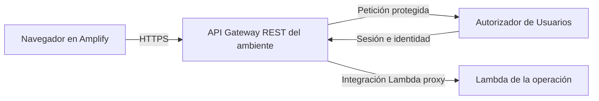

# Ambientes dev, test y prod

La rama define un API Gateway REST regional por ambiente. El stack `trazora-shared-<stage>` es dueño del gateway, del autorizador, del tema SNS y de los recursos de ruta `/visitas` y `/visitas/{visita_id}` que usan tanto Agenda como Partes. Cada servicio publica sus métodos en ese gateway, que invoca directamente a sus Lambdas. El login es la única ruta de negocio pública. MS0 verifica el token opaco y el estado del usuario en cada autorización. El navegador conserva las mismas 47 rutas y los mismos siete nombres de configuración.

| Recurso | dev | test | prod |
|---|---|---|---|
| API regional | trazora-dev | trazora-test | trazora-prod |
| URL de negocio | https://{id-dev}.execute-api.{región}.amazonaws.com/dev | https://{id-test}.execute-api.{región}.amazonaws.com/test | https://{id-prod}.execute-api.{región}.amazonaws.com/prod |
| Stacks | trazora-shared-dev y api-{servicio}-dev | trazora-shared-test y api-{servicio}-test | trazora-shared-prod y api-{servicio}-prod |
| 60 Lambda | api-{servicio}-dev-{función} | api-{servicio}-test-{función} | api-{servicio}-prod-{función} |
| Ocho tablas | dev-t_{entidad} | test-t_{entidad} | prod-t_{entidad} |
| Bucket privado | trazora-evidencias-dev-{cuenta} | trazora-evidencias-test-{cuenta} | trazora-evidencias-prod-{cuenta} |
| Tema SNS | dev-fsm-eventos | test-fsm-eventos | prod-fsm-eventos |
| Colas y DLQ | dev-q-{consumidor} y sufijo -dlq | test-q-{consumidor} y sufijo -dlq | prod-q-{consumidor} y sufijo -dlq |
| Pepper de MS0 | opcional, trazora/dev/usuarios/password-pepper | trazora/test/usuarios/password-pepper | trazora/prod/usuarios/password-pepper |
| Logs de Lambda | 7 días | 7 días | 14 días |
| Orígenes de carga S3 | Amplify dev y localhost:5173 | Amplify test y localhost:5173 | Origen de prod pasado por el despliegue |

Las ocho entidades son usuarios, sesiones, clientes, técnicos, órdenes, agenda, partes y analítica. En nombres de AWS se escriben sin tildes. MS0 posee las dos primeras. Los consumidores de las tres colas son Agenda, Órdenes y Analítica. Cada DLQ retiene durante 14 días. Técnicos también produce un evento de ausencia y tiene barrido de OUTBOX, además de los de Órdenes, Agenda y Partes que muestra el diagrama aportado. Las cuatro reglas ejecutan un barrido cada cinco minutos.

## Verificación local

`python scripts/validar_ambientes.py` ejecuta `serverless print` para los ocho stacks y los tres ambientes. Requiere las dependencias Node del proyecto y el acceso normal a Serverless v4. El script pasa identificadores y salidas de CloudFormation sintéticos y comprueba el gateway, que no haya VPC ni ALB, las rutas, el autorizador, nombres de recursos, origen S3, secretos, retención, consumidores y ausencia de coincidencias entre ambientes. Los argumentos `--cli`, `--node` y `--salida` permiten utilizar una instalación local concreta y guardar las 24 configuraciones resueltas. Los nombres entre llaves de la tabla representan valores que asigna AWS.

## Migración desde el despliegue existente

La cuenta consultada en us-east-1 tiene siete REST API de dev. La rama cambia sus identificadores y la URL que consume Amplify. Antes de aplicar una migración, comparar el inventario con el change set del stack compartido y de cada servicio. Identificar reemplazos de métodos y gateways y comprobar que tablas, bucket, tema, colas y mappings conservan sus IDs. Una diferencia en el propietario del tema o de una cola requiere resolver la propiedad en CloudFormation antes de continuar. En el inventario consultado esos recursos de dev sí pertenecen a stacks.

Para ensayar la migración en una operación futura, usar test vacío, resolver las salidas de shared, publicar Usuarios antes de los servicios que utilizan el autorizador y actualizar los servicios en el orden de `deploy.sh`. Los despliegues de métodos de un gateway compartido deben ser secuenciales porque cada uno publica una instantánea del API. Verificar las 47 rutas y el aislamiento con dos empresas antes de cambiar la URL del frontend. En dev o prod ya existentes, conservar una copia de las URLs, de la versión de frontend y de los change sets. Si el change set elimina un gateway todavía en uso, la transición necesita una ventana acordada o una publicación en paralelo antes del corte. Revertir el cambio de frontend solo sirve mientras los endpoints anteriores sigan vivos. La nueva retención de logs también afecta a entradas históricas de mayor antigüedad.

## Entrada de las 47 rutas

`trazora-shared-<stage>` crea un único API Gateway REST regional, el autorizador, las respuestas 4XX/5XX con CORS, `/visitas`, `/visitas/{visita_id}` y el tema SNS. No crea VPC, VPC Link ni ALB: las Lambdas no están en una VPC y API Gateway las invoca como servicio de AWS. Los handlers acceden a DynamoDB, S3, SNS y SQS por sus endpoints de servicio.

Cada declaración `http` de Serverless produce un método REST con integración `AWS_PROXY` hacia su Lambda, colgado del gateway compartido (`restApiId` y `restApiRootResourceId` salen de las salidas del stack compartido). Los métodos `OPTIONS` responden al preflight desde el gateway.

El autorizador `REQUEST` comprueba el token opaco en cada petición protegida, sin caché (TTL 0), y devuelve a la Lambda el contexto validado por MS0: `usuario_id`, `tenant_id`, `rol` y `tecnico_id`. Las Lambdas leen esa identidad de `requestContext.authorizer`. Login es la única ruta pública. Los archivos de evidencia viajan entre el navegador y S3 con URLs firmadas.

Los servicios se llaman entre sí por la URL única del gateway (`ApiUrl`) o por invocación Lambda directa, y por eventos SNS/SQS. Ya no hay dependencias de URL entre stacks de servicios, solo del stack compartido, que debe desplegarse primero.

### Prueba en AWS Academy previa a una migración

1. Con la sesión temporal de Learner Lab en `us-east-1`, confirmar la identidad con `aws sts get-caller-identity`. Inventariar stacks y APIs. Comprobar los permisos efectivos de la sesión y de `LabRole`, la concurrencia de Lambda y el presupuesto restante.
2. Confirmar que `test` sea un ambiente aislado y usar datos sintéticos. Preparar y revisar Change Sets sin ejecutarlos. Empezar por shared y continuar con Usuarios y los otros servicios. Detenerse ante eliminaciones, reemplazos de recursos con estado o cambios de propietario.
3. Tras aprobar el despliegue, publicar secuencialmente el stack compartido y los siete servicios en `test` según el orden de `deploy.sh`. Con la URL HTTPS de `execute-api`, verificar login, 401 sin sesión, aislamiento entre empresas, métodos con parámetros, Analítica y procesamiento asíncrono. Ensayar el frontend de test después de verificar el backend.
