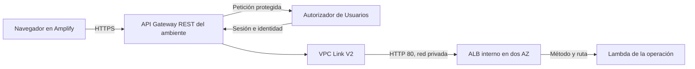

# Ambientes dev, test y prod

La rama define un API Gateway REST regional por ambiente. El stack `trazora-shared-<stage>` es dueño del gateway, del autorizador, del tema SNS y de los recursos de ruta `/visitas` y `/visitas/{visita_id}` que usan tanto Agenda como Partes. Cada servicio publica sus métodos en ese gateway. El login es la única ruta de negocio pública. MS0 verifica el token opaco y el estado del usuario en cada autorización. El navegador conserva las mismas 47 rutas y los mismos siete nombres de configuración.

| Recurso | dev | test | prod |
|---|---|---|---|
| VPC y ALB | trazora-dev, 2 AZ | trazora-test, 2 AZ | trazora-prod, 2 AZ |
| API regional | trazora-dev | trazora-test | trazora-prod |
| URL de negocio | https://{id-dev}.execute-api.{región}.amazonaws.com/dev | https://{id-test}.execute-api.{región}.amazonaws.com/test | https://{id-prod}.execute-api.{región}.amazonaws.com/prod |
| Stacks | trazora-shared-dev y api-{servicio}-dev | trazora-shared-test y api-{servicio}-test | trazora-shared-prod y api-{servicio}-prod |
| 60 Lambda | api-{servicio}-dev-{función} | api-{servicio}-test-{función} | api-{servicio}-prod-{función} |
| Ocho tablas | dev-t_{entidad} | test-t_{entidad} | prod-t_{entidad} |
| Bucket privado | trazora-evidencias-dev-{cuenta} | trazora-evidencias-test-{cuenta} | trazora-evidencias-prod-{cuenta} |
| Tema SNS | dev-fsm-eventos | test-fsm-eventos | prod-fsm-eventos |
| Colas y DLQ | dev-q-{consumidor} y sufijo -dlq | test-q-{consumidor} y sufijo -dlq | prod-q-{consumidor} y sufijo -dlq |
| Pepper de MS0 | opcional, trazora/dev/usuarios/password-pepper | trazora/test/usuarios/password-pepper | trazora/prod/usuarios/password-pepper |
| Logs de Lambda | 7 días | 7 días | 14 días |
| Orígenes de carga S3 | Amplify dev y localhost:5173 | Amplify test y localhost:5173 | Origen de prod pasado por el despliegue |

Las ocho entidades son usuarios, sesiones, clientes, técnicos, órdenes, agenda, partes y analítica. En nombres de AWS se escriben sin tildes. MS0 posee las dos primeras. Los consumidores de las tres colas son Agenda, Órdenes y Analítica. Cada DLQ retiene durante 14 días. Técnicos también produce un evento de ausencia y tiene barrido de OUTBOX, además de los de Órdenes, Agenda y Partes que muestra el diagrama aportado. Las cuatro reglas ejecutan un barrido cada cinco minutos.

## Verificación local

`python scripts/validar_ambientes.py` ejecuta `serverless print` para los ocho stacks y los tres ambientes. Requiere las dependencias Node del proyecto y el acceso normal a Serverless v4. El script pasa identificadores y salidas de CloudFormation sintéticos y comprueba el gateway, las rutas, el autorizador, nombres de recursos, origen S3, secretos, retención, consumidores y ausencia de coincidencias entre ambientes. Los argumentos `--cli`, `--node` y `--salida` permiten utilizar una instalación local concreta y guardar las 24 configuraciones resueltas. Los nombres entre llaves de la tabla representan valores que asigna AWS.

## Migración desde el despliegue existente

La cuenta consultada en us-east-1 tiene siete REST API de dev. La rama cambia sus identificadores y la URL que consume Amplify. Antes de aplicar una migración, comparar el inventario con el change set del stack compartido y de cada servicio. Identificar reemplazos de métodos y gateways y comprobar que tablas, bucket, tema, colas y mappings conservan sus IDs. Una diferencia en el propietario del tema o de una cola requiere resolver la propiedad en CloudFormation antes de continuar. En el inventario consultado esos recursos de dev sí pertenecen a stacks.

Para ensayar la migración en una operación futura, usar test vacío, resolver las salidas de shared, publicar Usuarios antes de los servicios que utilizan el autorizador y actualizar los servicios en el orden de `deploy.sh`. Los despliegues de métodos de un gateway compartido deben ser secuenciales porque cada uno publica una instantánea del API. Verificar las 47 rutas y el aislamiento con dos empresas antes de cambiar la URL del frontend. En dev o prod ya existentes, conservar una copia de las URLs, de la versión de frontend y de los change sets. Si el change set elimina un gateway todavía en uso, la transición necesita una ventana acordada o una publicación en paralelo antes del corte. Revertir el cambio de frontend solo sirve mientras los endpoints anteriores sigan vivos. La nueva retención de logs también afecta a entradas históricas de mayor antigüedad.

## Ingreso privado de las 47 rutas

`trazora-shared-<stage>` crea una VPC aislada, dos subredes privadas en AZ distintas, un VPC Link V2 y un ALB interno con listener HTTP en el puerto 80. El grupo de seguridad del enlace solo permite TCP 80 hacia el grupo del ALB. Las subredes usan la ruta local de la VPC. El ALB invoca las funciones mediante el servicio Lambda. Los handlers siguen accediendo a DynamoDB, S3, SNS y SQS con el modelo previo.

Cada declaración `http` de Serverless produce una integración REST `HTTP_PROXY` con el **ARN del ALB** y el ID del enlace. La regla del listener usa el **ARN del listener**, el verbo HTTP y la ruta. Las rutas literales, como `/ordenes/mapa`, preceden a las parametrizadas. El ALB admite el prefijo del stage que puede añadir API Gateway y responde 404 cuando ninguna regla coincide. Cada grupo tiene un target Lambda y un permiso de invocación acotado a la cuenta y al nombre de ese grupo. Los métodos `OPTIONS` responden al preflight desde el gateway. [Integración privada de API Gateway REST](https://docs.aws.amazon.com/apigateway/latest/developerguide/set-up-private-integration.html) · [Prefijo de stage](https://docs.aws.amazon.com/apigateway/latest/developerguide/private-integration.html)

El autorizador `REQUEST` comprueba el token opaco en cada petición protegida y rechaza cabeceras internas aportadas por el cliente. Gateway obtiene `X-Trazora-Identity` exclusivamente de `context.authorizer.identidadAlb`. La cabecera transporta en base64 los cuatro campos validados por MS0. La confianza procede del autorizador, del mapeo y del acceso restringido al listener. El adaptador comprueba la identidad y reconstruye los parámetros, los encabezados y la respuesta multivalor que necesita el ALB. Login ignora la identidad entrante. El límite del target Lambda es 1 MB para el cuerpo de la solicitud y 1 MB para el JSON de respuesta. Los archivos de evidencia siguen viajando entre el navegador y S3 con URLs firmadas. [Eventos, respuestas y límites de Lambda con ALB](https://docs.aws.amazon.com/elasticloadbalancing/latest/application/lambda-functions.html)

### Despliegue sin ACM en AWS Academy

API Gateway conserva su endpoint público HTTPS `execute-api` con TLS administrado por AWS. El VPC Link V2 entra por **HTTP/80** al **ALB interno** y restringe el acceso por Security Groups a la comunicación entre el enlace y el balanceador; no hace falta un dominio propio ni un certificado de ACM. `AlbUrl` se construye desde el DNS del ALB que entrega CloudFormation, sin ningún dominio ficticio.

**Límite de seguridad:** esta variante no cifra con TLS el tramo privado API Gateway → ALB. El aislamiento de red no equivale a cifrado. Está diseñada como vía de despliegue académico en AWS Academy y requiere una revisión de riesgos antes de utilizarla con credenciales, información sensible o tráfico de producción real. Si se necesita TLS de extremo a extremo, deberá volver a configurarse un listener HTTPS con un certificado válido y un nombre DNS verificado, en otro cambio controlado.

Los CIDR de dev, test y prod son `10.80.0.0/16`, `10.81.0.0/16` y `10.82.0.0/16`. En Virginia se usan `use1-az1` y `use1-az2`. Para otra región, elegir dos AZ admitidas y definir `TRAZORA_AZ_ID_A` y `TRAZORA_AZ_ID_B` en `config.env` para el stack compartido. [Regiones y zonas del VPC Link V2](https://docs.aws.amazon.com/apigateway/latest/developerguide/apigateway-vpc-links-v2.html)

### Prueba en AWS Academy previa a una migración

1. Con la sesión temporal de Learner Lab en `us-east-1`, confirmar la identidad con `aws sts get-caller-identity`. Inventariar stacks, APIs, enlaces, ALB y las dos AZ. Comprobar los permisos efectivos de la sesión y de `LabRole`, la concurrencia de Lambda, las cuotas de red y el presupuesto restante.
2. Confirmar que `test` sea un ambiente de prueba aislado y usar datos sintéticos. Preparar y revisar Change Sets sin ejecutarlos. Empezar por shared y continuar con Usuarios y los otros servicios a medida que estén disponibles las salidas reales de las dependencias. Detenerse ante eliminaciones, reemplazos de recursos con estado o cambios de propietario. Si ya existe un listener en 443, coordinar la actualización de shared y de los métodos REST. Un cambio de puerto y de URI en stacks distintos puede interrumpir la API mientras se completa la transición.
3. Tras aprobar el despliegue y revisar los cambios, publicar secuencialmente el stack compartido y los siete servicios en `test` según el orden de `deploy.sh`. Comprobar el estado del enlace, el listener HTTP/80 y los grupos de seguridad. Usar la URL HTTPS de `execute-api` para verificar login, 401 sin sesión, aislamiento entre empresas, métodos con parámetros, Analítica y procesamiento asíncrono. Ensayar el frontend de test después de verificar el backend.

### Consulta de AWS Academy

El 16 de noviembre de 2026, STS identificó la sesión de Academy como `voclabs`. El stack `trazora-shared-dev` carecía de rol de servicio asignado, por lo que CloudFormation usaría los permisos de la identidad que lo actualice. Las Lambdas del proyecto se configuran con `LabRole`.

En us-east-1, `SimulatePrincipalPolicy` devolvió `allowed` para ambos roles en `apigateway:POST` sobre `/vpclinks` y `elasticloadbalancing:CreateLoadBalancer` con esquema `internal`. También permitió crear el listener HTTPS, las reglas y los grupos de destino, registrar las Lambda y crear el rol vinculado de ELB, que aún faltaba en esa cuenta. Las dos AZ estaban disponibles. La cuota observada fue de 10 VPC Link V2 por región y de 100 reglas y 100 grupos de destino por ALB.

La consulta de ACM devolvió cero certificados en la región. **Esta falta ya no bloquea el despliegue del diseño HTTP privado.** Aún deben comprobarse los permisos efectivos para VPC Link V2, ELB, CloudFormation, los límites y el presupuesto, autenticar Serverless v4 y verificar el flujo administrado. La simulación anterior de HTTPS fue solo una comprobación de permisos; no constituye un despliegue de este diseño.
