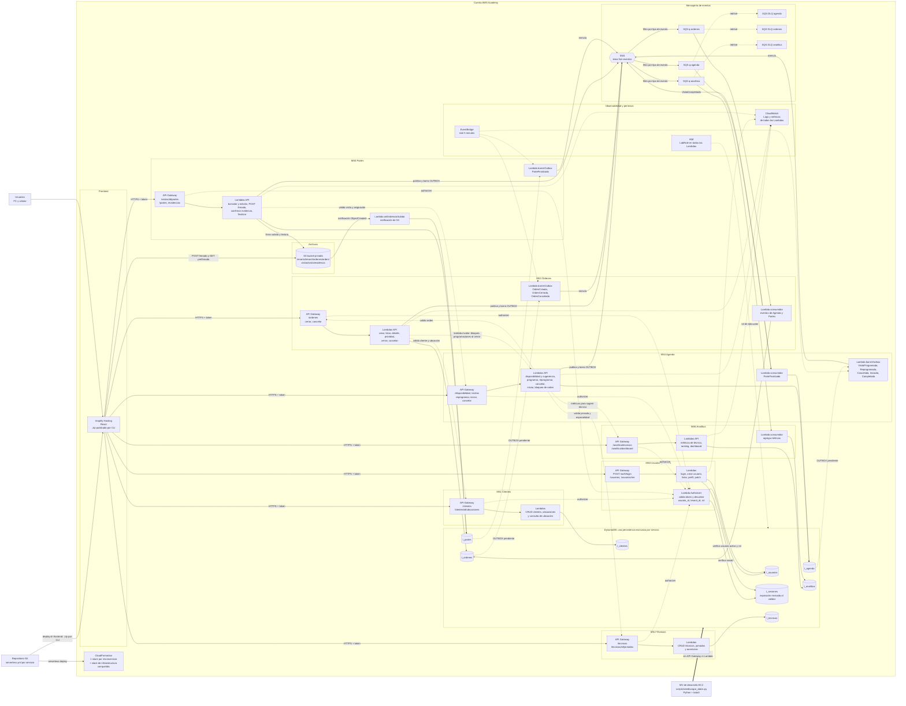
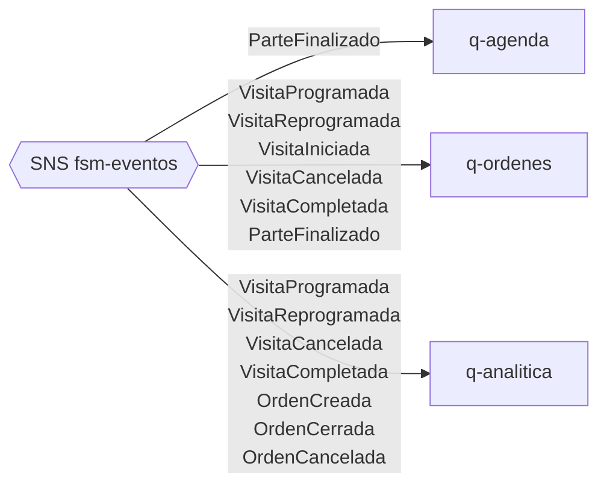

# Trazora FSM — Arquitectura técnica en AWS

Vista técnica de **todos los recursos AWS** desplegados, derivada de la [propuesta final](proposal.md) y comprobada contra el código de `backend/`. Los diagramas están en Mermaid.

- Flechas continuas: invocación o flujo de datos.
- Flechas punteadas: llamadas internas entre servicios, redrive o barrido.
- Las tablas y colas llevan el stage como prefijo, por ejemplo `dev-t_ordenes` y `dev-q-agenda`.

## 1. Diagrama general

## 2. Filtros de suscripción SNS → SQS

Cada cola recibe solo los eventos que consume. El filtro se declara en la suscripción (atributo `event_type` del mensaje).

## 3. Inventario de recursos

| Recurso AWS | Cantidad | Detalle |
|---|---:|---|
| Amplify Hosting | 1 app | React, rama `main`, publicada con un `.zip` por CLI. Las URLs de las 7 APIs se fijan al compilar. |
| API Gateway | 7 REST | Una por microservicio, con integración proxy. Todas usan el Lambda Authorizer de MS0, salvo `POST /auth/login`. |
| Lambda Authorizer | 1 | `validarToken`, del stack de MS0. Tipo TOKEN con 60 s de caché. |
| Lambdas de API | Una por operación | Definidas en cada `backend/<servicio>/serverless.yml`. |
| Lambda interna | 1 | `bloquearOrden`, sin ruta: la invoca MS3 con `lambda.invoke`. |
| Lambdas programadas | 3 | `barrerOutbox` en MS3, MS4 y MS5, con EventBridge cada 5 minutos. |
| Lambdas consumidoras | 3 | MS3, MS4 y MS6, disparadas por SQS con `batchSize: 1` y `maximumConcurrency: 2`. |
| Lambda de notificación | 1 | `onEvidenciaSubida`, disparada por el bucket de S3. |
| DynamoDB | 8 tablas | `t_usuarios`, `t_sesiones`, `t_clientes`, `t_tecnicos`, `t_ordenes`, `t_agenda`, `t_partes`, `t_analitica`. Bajo demanda y sin Streams. |
| SNS | 1 tema | `fsm-eventos`, con 3 suscripciones filtradas. |
| SQS | 3 colas + 3 DLQ | `q-agenda`, `q-ordenes`, `q-analitica` y su cola de errores cada una. Visibilidad de 120 s y 5 intentos. |
| S3 | 1 bucket | Privado. Acceso solo con formularios y URLs firmados por MS5. |
| EventBridge | 3 reglas | Las de los barridos. |
| CloudWatch | — | Grupos de logs por Lambda. |
| CloudFormation | 7 + 1 | Un stack por microservicio y uno compartido, generados por Serverless Framework. |
| IAM | `LabRole` | Único rol disponible en el laboratorio. |
| EC2 | 1 MV | Solo para la carga inicial con boto3; no forma parte de la ejecución. |

## 4. Notas técnicas

- **Propiedad de datos:** cada Lambda accede únicamente a la tabla de su servicio. Las consultas entre servicios pasan por la API del otro servicio, nunca por su tabla. Con `LabRole`, IAM no lo impone: lo comprueba `backend/common/tests/test_arquitectura.py`.
- **Outbox e inbox:** los registros `OUTBOX` viven en la tabla del productor y los `INBOX` en la del consumidor. Se escriben en la misma transacción que el cambio de negocio.
- **Por qué sin Streams:** publicar desde la misma Lambda y barrer lo pendiente da la misma garantía con menos Lambdas activas, lo que ayuda a respetar el límite de concurrencia de Academy.
- **Analítica es opcional en ejecución:** si `API6` no responde, MS4 sigue programando visitas en orden alfabético y sin justificación. Se comprobó en AWS apuntando Agenda a una URL inválida.
- **Carga masiva:** escribe directo a DynamoDB con boto3, en un solo proceso. No pasa por API Gateway ni Lambda ni publica eventos: no consume concurrencia.
- **Token:** opaco (UUID4), con su hash SHA-256 en `t_sesiones`. La caché del autorizador puede retrasar hasta 60 s la revocación de una sesión o de un usuario inactivo.
- **Filtro SNS:** los productores envían `event_type` como atributo del mensaje; la política de filtrado de cada suscripción se basa en ese atributo.
- **Evidencias:** el bucket permite `POST` y `GET` desde el dominio de Amplify. `content-length-range` hace que S3 rechace archivos de más de 5 MB.
- **Región:** `us-east-1`.
