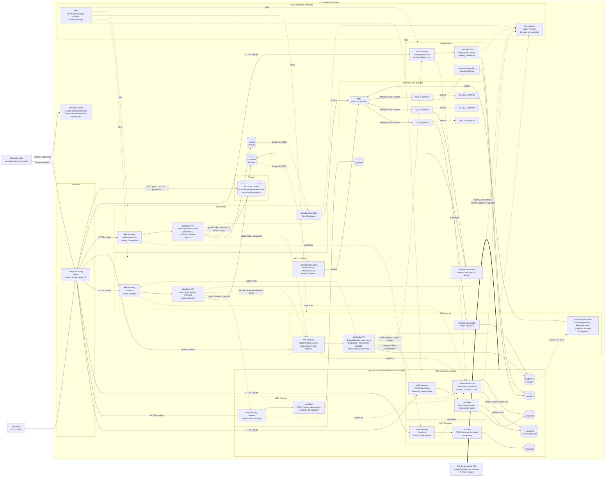
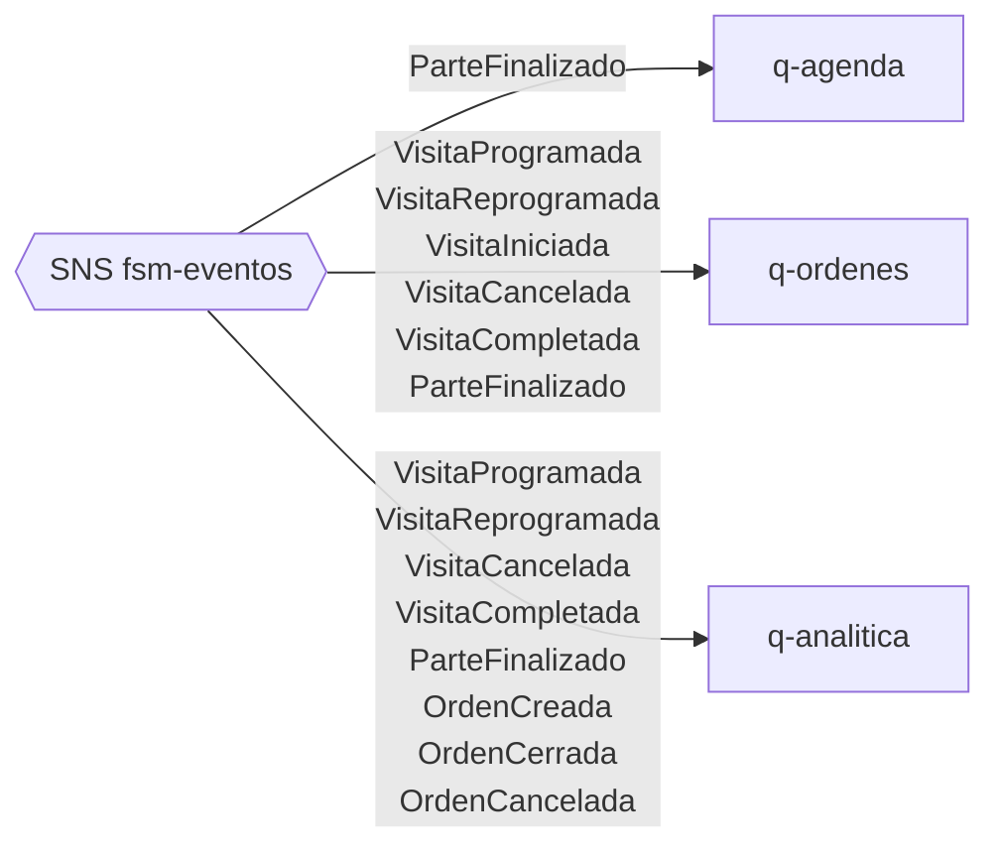

# Trazora FSM — Arquitectura técnica en AWS

Vista técnica de **todos los recursos AWS** que se desplegarán, derivada de la [propuesta final](proposal.md). Los diagramas están en Mermaid.

- Flechas continuas: invocación o flujo de datos.
- Flechas punteadas: llamadas internas entre servicios, streams, redrive o permisos.
- Los nombres de tablas, colas y funciones son orientativos; el sufijo `-{stage}` se define al desplegar.

## 1. Diagrama general

## 2. Filtros de suscripción SNS → SQS

Cada cola recibe solo los eventos que consume. El filtro se declara en la suscripción (atributo `event_type` del mensaje).

## 3. Inventario de recursos

| Recurso AWS | Cantidad | Detalle |
|---|---:|---|
| Amplify Hosting | 1 app | React, rama `main`, variables con las URLs de las 7 APIs. |
| API Gateway | 7 | Una por microservicio. MS1–MS6 usan el Lambda Authorizer de MS0. En MS0, `login` es público y sus demás rutas validan el token dentro del propio servicio. |
| Lambda Authorizer | 1 | Pertenece al stack de MS0 y las APIs de MS1–MS6 lo referencian. |
| Lambdas de API | por servicio | Una función por operación o grupo de operaciones. |
| Lambdas publicadoras | 3 | MS3, MS4 y MS5, disparadas por DynamoDB Streams. |
| Lambdas consumidoras | 3 | MS3, MS4 y MS6, disparadas por SQS. |
| DynamoDB | 8 tablas | `t_usuarios`, `t_sesiones`, `t_clientes`, `t_tecnicos`, `t_ordenes`, `t_agenda`, `t_partes`, `t_analitica`. Streams en órdenes, agenda y partes. |
| SNS | 1 tema | `fsm-eventos`, con 3 suscripciones filtradas. |
| SQS | 3 colas + 3 DLQ | `q-agenda`, `q-ordenes`, `q-analitica` y su cola de errores cada una. |
| S3 | 1 bucket | Privado. Acceso solo mediante URLs prefirmadas emitidas por MS5. |
| CloudWatch | — | Grupos de logs por Lambda y alarmas sobre las DLQ. |
| CloudFormation | 1 por servicio + compartido | Generado por Serverless Framework. |
| EC2 | 1 MV | Solo para la carga inicial con boto3; no forma parte del runtime. |

## 4. Notas técnicas

- **Propiedad de datos:** cada Lambda accede únicamente a la tabla de su servicio. Las consultas entre servicios pasan por la API del otro servicio, nunca por su tabla.
- **Outbox e inbox:** los registros `OUTBOX` viven en la tabla del productor y los `INBOX` en la del consumidor. Se escriben en la misma transacción que el cambio de negocio.
- **Analítica es opcional en runtime:** si `API6` no responde, MS4 sigue programando visitas con el orden por defecto.
- **Carga masiva:** la MV escribe directo a DynamoDB con credenciales temporales de AWS Academy, como pidió el docente. No pasa por API Gateway ni Lambda.
- **IAM en AWS Academy:** en el laboratorio suele estar disponible solo el rol preexistente `LabRole`. Hay que verificar si el despliegue puede crear un rol por Lambda; si no, todas usarán `LabRole` y la separación de permisos quedaría documentada pero no aplicada por IAM.
- **Mecanismo de token pendiente:** el diagrama asume tokens opacos con sesión en `t_sesiones`. Si se elige un token firmado y verificable (decisión abierta en la sección 9.1 de la propuesta), `t_sesiones` puede omitirse y quedaría 1 tabla menos en MS0.
- **Caché del autorizador:** conviene activar la caché de resultados del Lambda Authorizer en API Gateway (TTL corto). Sin ella, cada petición consulta DynamoDB dos veces. La caché retrasa unos segundos la revocación de una sesión o usuario inactivo.
- **Filtro SNS:** las publicadoras envían `event_type` como atributo del mensaje; la política de filtrado de cada suscripción se basa en ese atributo.
- **CORS en S3:** el bucket necesita una regla CORS que permita `PUT` y `GET` desde el dominio de Amplify, porque el navegador sube y descarga con URLs prefirmadas.
- **Recuperación de eventos:** el comando de `scripts/recovery/` vuelve a publicar en SNS los registros `OUTBOX` pendientes. Se ejecuta a demanda y no es un recurso permanente.
- **Región:** por definir al fijar el entorno. Todos los recursos deben desplegarse en la misma región.
