# Trazora FSM

## Propuesta y plan de implementación — Grupo 5

**Curso:** CS2032 — Cloud Computing, ciclo 2026-2  
**Tipo de proyecto:** Field Service Management, como Software as a Service en AWS  
**Fecha de la propuesta inicial:** 27 de octubre de 2026  
**Actualización:** 29 de octubre de 2026 — versión 2.0, revisada con la transcripción de indicaciones docentes  
**Rubro propuesto:** instalación, reparación y mantenimiento de aire acondicionado  
**Nombre provisional:** Trazora FSM  
**Concepto del nombre:** combina *trazabilidad* y *operación*. Lema propuesto: **«Cada visita bajo control»**. Es una propuesta creativa; la disponibilidad comercial del nombre no ha sido verificada.

> **Idea central:** construir una aplicación que permita a varias empresas de servicio técnico organizar a sus clientes, su personal, sus órdenes de trabajo, sus visitas y las evidencias de cada atención. Cada empresa utiliza la misma plataforma, con acceso únicamente a la información que le corresponde.

Este documento es una propuesta para implementar. Los requisitos académicos se identifican como **obligatorios según el enunciado**; las decisiones de producto y arquitectura se presentan como **diseño propuesto**. Las fechas internas son metas del equipo, mientras que los plazos oficiales se identifican expresamente.

### Cambios de la versión 2.0 — ajuste a la explicación del profesor

Esta actualización contrasta el plan anterior con la transcripción **«Proyecto final audio desde 46m»** [F16]. Se mantiene el alcance FSM, pero se realizan cuatro ajustes:

1. **MS0 Usuarios y acceso (nuevo):** administración de usuarios separada por tenant, con su propia persistencia; se mantienen los cinco servicios de negocio, de modo que el diseño tiene **seis microservicios**. El docente pidió explícitamente un microservicio de usuarios multitenant.
2. **Carga de datos:** los registros se preparan con **Python y boto3 desde una máquina virtual directamente hacia DynamoDB**, no mediante peticiones masivas a API Gateway/Lambda.
3. **Volumen del MS0:** el discurso dice «30 000 registros por cada microservicio» sin aclarar una excepción para Usuarios. Se documenta la **duda pendiente** y una estrategia contingente que no crea cuentas de acceso activas en masa.
4. **Identidad en AWS Academy:** se prioriza un mecanismo compatible con los recursos efectivos del laboratorio (modelo de tokens visto en clase), en vez de depender de Cognito, señalado como no disponible en el Taller Serverless 1 [F17].

**No se modifican:** el rubro, los tres tenants, los estados de orden y visita, los cinco módulos de negocio, los eventos previstos, la rúbrica ni los hitos académicos.

Los diagramas están escritos en **Mermaid**, dentro del propio Markdown. Se pueden visualizar en GitHub o en un lector/editor que admita Mermaid. Cada diagrama explica una parte de la solución; las vistas se complementan.

---

## Índice

1. [Problema, producto y objetivo](#1-problema-producto-y-objetivo)
2. [Requisitos del curso y cómo se demostrarán](#2-requisitos-del-curso-y-cómo-se-demostrarán)
3. [Conceptos del negocio, empresas y usuarios](#3-conceptos-del-negocio-empresas-y-usuarios)
4. [Alcance de la primera versión](#4-alcance-de-la-primera-versión)
5. [Recorrido completo de una atención](#5-recorrido-completo-de-una-atención)
6. [Arquitectura general en AWS](#6-arquitectura-general-en-aws)
7. [Los seis microservicios](#7-los-seis-microservicios)
8. [Conexiones y contratos entre componentes](#8-conexiones-y-contratos-entre-componentes)
9. [Identidad, permisos y separación entre empresas](#9-identidad-permisos-y-separación-entre-empresas)
10. [Diseño inicial de los datos](#10-diseño-inicial-de-los-datos)
11. [Flujos funcionales paso a paso](#11-flujos-funcionales-paso-a-paso)
12. [Eventos, reintentos y recuperación](#12-eventos-reintentos-y-recuperación)
13. [Carga de datos ficticios](#13-carga-de-datos-ficticios)
14. [Pantallas y experiencia de uso](#14-pantallas-y-experiencia-de-uso)
15. [Organización del código y despliegue](#15-organización-del-código-y-despliegue)
16. [Plan de trabajo y reparto del equipo](#16-plan-de-trabajo-y-reparto-del-equipo)
17. [Criterios de aceptación y pruebas](#17-criterios-de-aceptación-y-pruebas)
18. [Guion de demostración](#18-guion-de-demostración)
19. [Entregables, evaluación y fechas oficiales](#19-entregables-evaluación-y-fechas-oficiales)
20. [Decisiones que conviene dejar documentadas](#20-decisiones-que-conviene-dejar-documentadas)
21. [Primeras tareas concretas](#21-primeras-tareas-concretas)
22. [Fuentes](#22-fuentes)

---

## 1. Problema, producto y objetivo

### 1.1. El problema que vamos a resolver

Imaginemos una empresa que envía técnicos a reparar equipos de aire acondicionado. Durante el día recibe solicitudes, coordina horarios, asigna personal y recibe fotografías o mensajes sobre los trabajos realizados.

La empresa necesita saber:

- Qué clientes solicitaron atención y en qué lugar.
- Qué problemas están pendientes.
- Qué técnico tiene la especialidad y la jornada necesarias.
- Qué horarios ya están reservados.
- Si una visita se realizó, se reprogramó o se canceló.
- Qué se encontró durante la atención y qué se hizo.
- Si el problema quedó resuelto o requiere otra visita.

**Trazora centraliza ese recorrido en una aplicación web.** El coordinador organiza el trabajo desde su computadora y el técnico consulta sus visitas y registra la atención desde el navegador de su celular.

### 1.2. Propuesta de valor

La plataforma permitirá seguir una solicitud desde su registro hasta su cierre, manteniendo un historial por cliente, orden y visita. El coordinador podrá distribuir la carga de trabajo y el técnico contará con instrucciones y un formulario de atención.

El producto se ofrece a **empresas de servicio técnico**. Cada empresa administra a sus propios clientes y trabajadores.

### 1.3. Objetivo general

Desarrollar y desplegar en AWS un SaaS multitenant de gestión de servicios en campo, con **siete microservicios serverless protegidos (uno de usuarios, cinco de negocio y uno de analítica)**, que permita administrar identidades por empresa, registrar clientes, administrar técnicos, gestionar órdenes, programar visitas, documentar atenciones mediante archivos y eventos, y tomar decisiones de asignación basadas en métricas históricas por técnico y tenant.

### 1.4. Referencias funcionales

ServiceTitan aporta referencias de despacho de técnicos, reprogramación y herramientas de trabajo en campo. Jobber aporta referencias de agenda, gestión de trabajos e información disponible durante la visita. Se tomarán estas funciones como inspiración para definir un alcance académico concreto. [F2] [F3]

No se plantea una integración con las APIs de esas plataformas: la propuesta consiste en desarrollar nuestro propio sistema.

## 2. Requisitos del curso y cómo se demostrarán

La referencia académica del plan anterior es el PDF **“2. Proyecto Final (Entrega Semana 15) V5.00 (1)”**, especialmente sus páginas 5, 6, 7 y 9. [F1] Para esta versión se añade la **transcripción de la explicación oral del docente** [F16], que especifica el microservicio de usuarios y la carga directa con boto3.

| Requisito obligatorio | Implementación propuesta | Evidencia de cumplimiento |
|---|---|---|
| Grupo 5: FSM | Gestión de servicios de aire acondicionado en instalaciones del cliente. | Problema, actores y recorrido completo de una atención. |
| SaaS en AWS | Aplicación web y backend desplegados en AWS. | URL funcional y recursos desplegados. |
| Multi-tenancy | Tres empresas con datos y usuarios asociados a su tenant. | Conteos por empresa y acceso cruzado rechazado. |
| Serverless | API Gateway y Lambda para las operaciones del backend. | Configuración declarativa e invocaciones reales. |
| Arquitectura basada en eventos | Una atención finalizada produce actualizaciones en Agenda y Órdenes. | Diagrama, evento y cambios visibles en la aplicación. |
| Mínimo cinco microservicios protegidos | **Siete:** Usuarios y acceso (MS0), Clientes, Técnicos, Órdenes, Agenda, Partes y Analítica (MS1–MS6). | Responsabilidades, rutas, código, tablas y permisos separados. |
| **Microservicio de usuarios multitenant (aclaración oral del profesor)** | MS0 con administración de usuarios y sesiones por empresa. | Acceso correcto por tenant, perfiles separados y prueba de intento de acceso cruzado. |
| Persistencia propia por servicio | Tabla o conjunto de tablas exclusivo de cada microservicio. | Relación servicio-tabla y permisos de acceso. |
| NoSQL con DynamoDB | Los seis servicios utilizarán DynamoDB, con persistencia exclusiva por servicio. | Tablas, claves e índices definidos. |
| Diseño de datos por servicio | Estructuras JSON y explicación de sus consultas. | Sección de datos del informe. |
| Mínimo 30 000 registros por microservicio, repartidos en tres tenants | Generador reproducible Python/boto3 con inserción directa; **pendiente definir expresamente si MS0 Usuarios también se incluye**. | Reporte de conteos por servicio y tenant; evidencia de carga sin API REST. |
| Uso de S3 | Fotos y documentos de atención. | Carga y consulta de una evidencia desde la aplicación. |
| Uso de SNS | Distribución de eventos de negocio. | Tema, publicaciones y suscripciones. |
| Uso de SQS | Cola independiente para cada consumidor. | Mensajes procesados por Lambdas de los servicios. |
| Frontend en Amplify | React desplegado en Amplify Hosting. | URL, configuración de compilación y despliegue. |
| Automatizar todo el despliegue con “framework serverless” | Serverless Framework y recursos declarados en configuración. | Procedimiento reproducible e infraestructura versionada. |
| Diagrama de arquitectura de solución | Vistas de APIs, datos, archivos y eventos. | Diagramas que coincidan con la implementación final. |
| Demo con dos tenants | Recorrido con ClimaLima y verificación con FríoSur. | Guion y demostración de separación. |

**Dos requisitos distintos:** deben existir datos para **tres tenants**, aunque la demo se ejecute con **dos**. [F16] El docente también indicó que cada tenant debe tener sus **propios usuarios**, no solo sus propios registros de negocio.

**Duda abierta:** la transcripción no exonera al nuevo servicio de Usuarios del volumen de 30 000 registros. Se solicitará confirmación antes de comprometer la cifra del MS0. [F16]

El enunciado permite SQL bajo una condición específica: un único RDS y el patrón **Single Database, Multiple Schemas**. Esta propuesta elige DynamoDB, por lo que no necesita incorporar RDS. [F1]

## 3. Conceptos del negocio, empresas y usuarios

### 3.1. Vocabulario básico

| Concepto | Explicación | Ejemplo |
|---|---|---|
| SaaS | Software al que sus organizaciones usuarias acceden como servicio. | Varias empresas utilizan Trazora desde internet. |
| Tenant | Empresa usuaria del sistema. | ClimaLima. |
| Usuario | Cuenta gestionada por MS0, asociada a una empresa y a un rol. | La coordinadora de ClimaLima. |
| Cliente | Persona u organización que recibe un servicio de esa empresa. | Una oficina que necesita reparar su equipo. |
| Ubicación | Lugar concreto donde se presta el servicio. | Oficina de Miraflores, piso 3. |
| Técnico | Trabajador que realiza la atención. | Carlos, especialista en equipos split. |
| Servicio | Tipo de trabajo ofrecido. | Instalación, mantenimiento o reparación. |
| Orden de trabajo | Trabajo solicitado que debe ser gestionado hasta su resolución o cancelación. | Reparar el equipo que no enfría. |
| Visita | Atención programada para una orden, con técnico y horario. | Carlos irá el martes de 10:00 a 11:00. |
| Parte de trabajo | Registro de lo que sucedió durante una visita. | Diagnóstico, tareas, resultado y evidencias. |
| Evento | Mensaje que informa un hecho ya registrado por un servicio. | Se finalizó un parte de trabajo. |
| API | Interfaz por la que un componente solicita operaciones a otro. | El frontend solicita crear una orden. |

### 3.2. Empresas ficticias

| tenant_id | Empresa | Actividad |
|---|---|---|
| CLIMALIMA | ClimaLima | Reparación e instalación de aire acondicionado. |
| FRIOSUR | FríoSur | Mantenimiento de equipos en oficinas y comercios. |
| TECNINORTE | TecniNorte | Servicios técnicos de climatización. |

Las tres empresas son ficticias. Sus nombres e identificadores se utilizan para los ejemplos y la carga de datos.

**Un cliente final no es un tenant.** El cliente final pertenece a la cartera de una empresa. Tampoco son tenants los roles administrador, coordinador y técnico. **ClimaLima, FríoSur y TecniNorte tendrán conjuntos de cuentas independientes**: ningún usuario puede tomar el `tenant_id` de otro tenant en una solicitud. [F16]

### 3.3. Roles propuestos

| Acción | Administrador | Coordinador | Técnico |
|---|---:|---:|---:|
| Administrar usuarios y permisos de su empresa | Sí | No | No |
| Registrar y consultar clientes | Sí | Sí | Solo datos necesarios para sus visitas |
| Administrar técnicos y jornadas | Sí | Sí | Consultar su información |
| Crear órdenes | Sí | Sí | No |
| Programar y reprogramar visitas | Sí | Sí | No |
| Iniciar una visita asignada | Según permiso | Según permiso | Sí |
| Registrar un parte y sus evidencias | Según permiso | Según permiso | Sí, en sus visitas |
| Revisar y cerrar una orden | Sí | Sí | No |

En la primera versión, el administrador puede cubrir también tareas de coordinación. Cada permiso se valida en el backend.

## 4. Alcance de la primera versión

### 4.1. Funciones incluidas

1. Gestionar usuarios por empresa, iniciar sesión y determinar empresa y rol desde identidad validada.
2. Registrar y consultar clientes y ubicaciones.
3. Registrar técnicos, especialidades, jornadas y ausencias.
4. Crear órdenes con servicio, descripción, prioridad y estado.
5. Consultar disponibilidad y asignar un técnico a una visita.
6. Reprogramar o cancelar visitas pendientes.
7. Consultar las visitas del técnico e iniciar una atención.
8. Registrar diagnóstico, tareas y resultado.
9. Subir y consultar evidencias en S3.
10. Actualizar Agenda y Órdenes mediante SNS y SQS.
11. Solicitar una segunda visita cuando el trabajo siga pendiente.
12. Revisar y cerrar la orden cuando se cumplan las condiciones.
13. Mostrar un panel con conteos y próximas atenciones.
14. Generar datos ficticios y evidenciar su distribución.

### 4.2. Restricciones propuestas para mantener el proyecto realizable

| Decisión | Regla inicial | Motivo |
|---|---|---|
| Personal por visita | Un técnico principal. | Facilita la asignación y el control de horarios. |
| Duraciones | Múltiplos de 30 minutos. | Permite reservar bloques de agenda de forma consistente. |
| Duración máxima inicial | Cuatro horas por visita; trabajos mayores se dividen. | Mantiene acotada la operación de reserva. |
| Movilidad | Web adaptada al celular. | Permite trabajo en campo con el mismo frontend. |
| Conectividad | Operación con internet. | La sincronización sin conexión se deja para otra versión. |
| Parte final | Un parte final por visita. | Evita duplicar resultados; las correcciones se gestionan como revisiones. |
| Cierre de orden | Confirmación del coordinador después de verificar las visitas. | Una atención terminada puede requerir seguimiento. |
| Tipos de servicio | Catálogo inicial de instalación, mantenimiento y reparación. | Evita agregar un servicio de catálogo independiente; el sexto microservicio es Usuarios. |

Estas reglas son decisiones del equipo, no condiciones adicionales escritas por el profesor.

### 4.3. Ampliaciones posteriores

GPS en vivo, optimización automática de rutas, aplicación móvil nativa, firma del cliente, inventario completo de repuestos, pagos, facturación fiscal, integración con WhatsApp e inteligencia artificial.

Para la primera versión se puede registrar “repuesto requerido” o “material utilizado” como información de la atención, sin implementar un sistema completo de inventario.

## 5. Recorrido completo de una atención

### Diagrama 1. Flujo del negocio

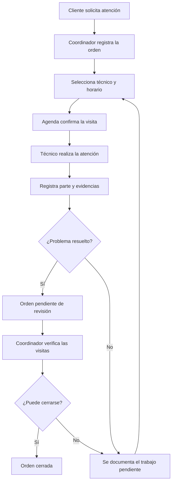

**Cómo leerlo:** la orden permanece durante todo el proceso. Si se necesita volver, se crea otra visita asociada a esa misma orden. El historial permite entender qué ocurrió en cada desplazamiento.

### Ejemplo que usaremos en todo el documento

- Empresa: ClimaLima.
- Cliente: Comercial López.
- Ubicación: oficina de Miraflores.
- Orden: OT-001, “el aire acondicionado no enfría”.
- Técnico: TEC-001, Carlos.
- Primera visita: VIS-001.
- Parte de la primera visita: PAR-001.

Si Carlos necesita un repuesto, PAR-001 indica `REQUIERE_REVISITA`. Se agenda VIS-002. Si la segunda visita resuelve el problema, su parte registra `RESUELTO`; después se revisa el cierre.

## 6. Arquitectura general en AWS

### 6.1. Vista de la aplicación, las APIs y los datos

### Diagrama 2. Arquitectura de acceso y persistencia

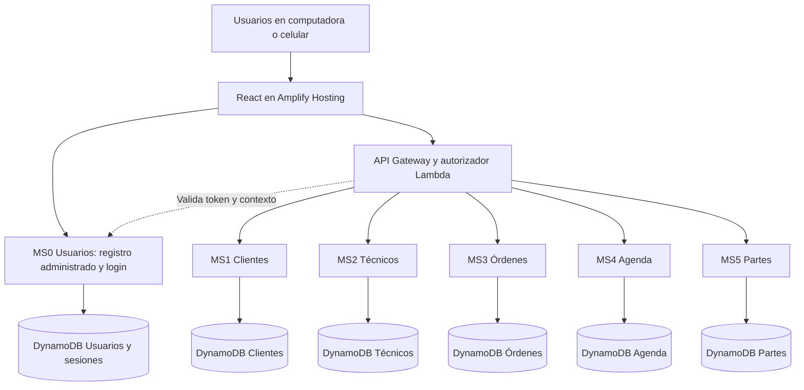

**Cada caja MS representa funciones Lambda de un microservicio**, no un servidor que deban mantener encendido. Un microservicio puede tener varias Lambdas para sus diferentes operaciones. Lambda administra la infraestructura de ejecución. [F4]

**Las flechas hacia DynamoDB indican propiedad de los datos.** MS0 conserva sus cuentas y sesiones; cada microservicio de negocio conserva sus propios datos. Por ejemplo, Agenda modifica su tabla de visitas y reservas. Para provocar un cambio en una orden, se comunica con el servicio de Órdenes.

La vista omite las conexiones entre servicios, los archivos y los eventos para mantenerla legible. Se explican en las siguientes secciones.

### 6.2. Papel de cada tecnología

| Tecnología | Qué hará en Trazora | Explicación sencilla |
|---|---|---|
| React | Pantallas y formularios. | Lo que ve y utiliza el usuario. |
| Amplify Hosting | Publicar el frontend. | Hace que la web esté disponible mediante una URL. |
| API Gateway | Exponer las rutas y aplicar la autorización configurada. | Recibe las solicitudes del navegador. |
| Lambda | Ejecutar validaciones y operaciones. | Procesa “crear orden”, “reservar visita”, etc. |
| DynamoDB | Persistencia de cada servicio. | Conserva los registros del negocio. |
| S3 | Fotografías y documentos. | Guarda los archivos adjuntos. |
| SNS | Publicar y distribuir eventos. | Envía el aviso a las áreas interesadas. |
| SQS | Colas de mensajes por consumidor. | Mantiene pendientes hasta que se procesen. |
| DynamoDB Streams | Disparar la publicación de cambios persistidos. | Detecta que hay un aviso nuevo por enviar. |
| CloudWatch | Registros y métricas de operación. | Ayuda a comprobar qué pasó cuando algo falla. |
| Serverless Framework | Desplegar la infraestructura declarada. | Crea y actualiza los recursos a partir de configuración versionada. |

Amplify admite React y despliegue vinculado con Git. [F5] S3 se utilizará para objetos, mientras que los metadatos de cada archivo pertenecerán al servicio de Partes. [F6]

**Obligatorios en el PDF:** API Gateway, Lambda, Amplify, S3, SNS y SQS; DynamoDB cuando se elige NoSQL. Streams y CloudWatch apoyan el diseño propuesto; no son microservicios de negocio adicionales.

### 6.3. Vista del procesamiento por eventos

### Diagrama 3. De un parte guardado a las actualizaciones del negocio

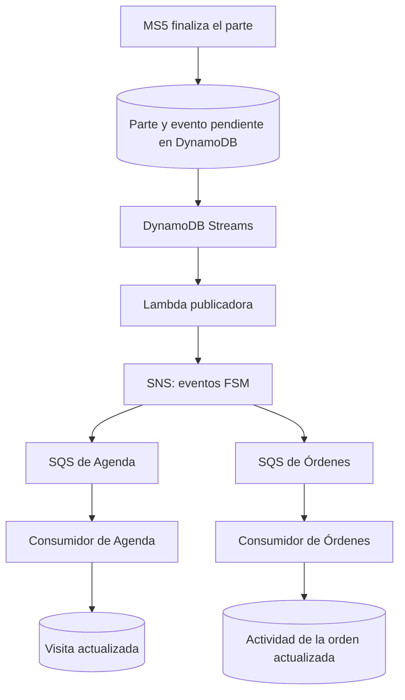

**Qué sucede aquí:** Partes deja registrado el resultado y que debe emitir un aviso. La publicadora envía el evento a SNS. Agenda y Órdenes reciben una copia mediante sus propias colas.

Agenda confirma la terminación de la visita y posteriormente publica `VisitaCompletada`, que también recibe Órdenes. Esta confirmación permite distinguir “se registró un informe” de “Agenda ya aplicó el cambio”.

La combinación SNS/SQS permite distribuir mensajes y procesarlos de forma desacoplada. [F7] La publicación recuperable y el tratamiento de duplicados se detallan en la sección 12.

## 7. Los seis microservicios

### 7.0. MS0 — Usuarios y acceso (añadido por indicación docente)

**Responsabilidad:** administrar usuarios y credenciales de acceso **dentro de cada tenant**, sin mezclar las cuentas de diferentes empresas. El docente lo pidió explícitamente en la explicación del proyecto [F16].

**Datos que administra:** usuarios, roles, estado (activo/bloqueado), referencias a identidad y sesiones/tokens de acceso. Las sesiones son datos técnicos y no deben contabilizarse como usuarios de negocio.

**Operaciones mínimas:** alta de usuario por administrador autorizado, login, consulta de perfil, listar usuarios del propio tenant, cambiar rol o estado bajo permiso y validar token en el autorizador.

**Reglas principales:**

- El identificador del tenant lo fija el mecanismo de identidad validado; **el frontend no puede seleccionar un tenant arbitrario para acceder a datos ajenos**.
- Un administrador de ClimaLima no administra ni lista usuarios de FríoSur; las búsquedas se realizan con claves que incorporan `tenant_id`.
- El usuario técnico puede estar asociado mediante `usuario_id` al perfil correspondiente de MS2, pero **MS2 no almacena ni valida contraseñas**.
- No guardar contraseñas en texto plano: usar una función robusta de derivación de claves y validar las credenciales en el backend. Los tokens deben expirar, validarse y no aparecer en registros.
- El registro público no permite asignar libremente el rol `ADMIN` ni pertenecer a cualquier tenant; las altas iniciales se realizan por un procedimiento autorizado.

**Pantallas:** inicio de sesión y gestión de usuarios para el administrador. **Infraestructura vinculada:** Lambda de autenticación/autorización, API Gateway y tablas DynamoDB propias del MS0.

**Alcance:** es un **sexto microservicio real**, no un alias de Cognito ni una tabla compartida entre los demás módulos. Su persistencia y sus permisos de acceso se despliegan de forma declarativa.


### 7.1. MS1 — Clientes y ubicaciones

**Responsabilidad:** identificar al cliente y el lugar de atención.

Guarda clientes, contactos y ubicaciones. Un cliente puede tener varias ubicaciones; por ejemplo, una empresa con dos oficinas.

**Operaciones propuestas:** registrar cliente, listar y buscar clientes, consultar detalle, actualizar datos y agregar una ubicación.

**Reglas principales:**

- El cliente y sus ubicaciones pertenecen a un tenant.
- Una orden debe referenciar una ubicación válida del cliente.
- Los registros que ya tienen historial se desactivan cuando corresponda, preservando las referencias.

**Pantallas:** listado, formulario y detalle del cliente con sus ubicaciones.

### 7.2. MS2 — Técnicos y jornadas

**Responsabilidad:** administrar al personal, sus especialidades y sus horas de trabajo.

Guarda perfiles de técnicos, especialidades, jornadas y ausencias. Las reservas concretas de visitas pertenecen a Agenda.

**Operaciones propuestas:** registrar técnico, activar o desactivar, actualizar especialidades, registrar jornadas y consultar disponibilidad laboral.

**Reglas principales:**

- Un técnico solo puede asignarse dentro de la empresa correspondiente.
- Debe estar activo y tener una especialidad compatible.
- La visita debe encajar en su jornada y no coincidir con una ausencia.
- Un cambio de jornada debe revisar sus visitas ya programadas y señalar conflictos para reprogramarlos.

**Pantallas:** técnicos, detalle del trabajador y configuración de jornadas.

### 7.3. MS3 — Órdenes de trabajo

**Responsabilidad:** gestionar el trabajo solicitado y su estado general.

Guarda la descripción, el cliente, la ubicación, la prioridad, el tipo de servicio, el estado y el historial.

**Operaciones propuestas:** crear orden, listar por estado, consultar detalle, cambiar prioridad, solicitar cierre y cancelar cuando se cumplan las reglas.

**Reglas principales:**

- Crear una orden no reserva automáticamente un horario.
- Una orden puede tener varias visitas.
- El resultado de una visita alimenta el historial, pero no cierra por sí solo toda la orden.
- El cierre requiere verificar que no quedan visitas activas y bloquear nuevas programaciones.

**Pantallas:** tablero/listado de órdenes, formulario y detalle con historial.

### 7.4. MS4 — Agenda y visitas

**Responsabilidad:** reservar horarios y gestionar las visitas.

Guarda visitas, asignaciones, bloques reservados y el control de programación de cada orden.

**Operaciones propuestas:** consultar horarios, programar, reprogramar, cancelar, iniciar una visita y consultar la agenda del técnico.

**Reglas principales:**

- La disponibilidad mostrada debe volver a validarse al confirmar.
- Dos visitas del mismo técnico no pueden ocupar un mismo bloque.
- Una reprogramación se confirma completa o conserva la reserva anterior.
- Una visita en atención no puede cancelarse o reasignarse con el flujo normal.
- Una visita completada conserva su historial.

**Pantallas:** agenda del coordinador y “Mis visitas” del técnico.

### 7.5. MS5 — Partes de trabajo y evidencias

**Responsabilidad:** documentar lo ocurrido en la atención.

Guarda diagnóstico, tareas, materiales descriptivos, resultado y referencias a los archivos.

**Operaciones propuestas:** crear o editar borrador, solicitar carga de evidencia, confirmar archivo, finalizar parte y consultar el informe.

**Reglas principales:**

- El técnico debe estar asignado a la visita y autorizado para atenderla.
- Se registra un resultado explícito: `RESUELTO`, `REQUIERE_REVISITA` o `NO_ATENDIDO`.
- Se permite un parte final por visita.
- Una evidencia se presenta como disponible después de confirmar que el archivo existe.
- Finalizar el parte genera un evento de negocio persistido.

**Pantallas:** formulario de atención, carga de archivos y detalle del parte.

### 7.6. MS6 — Analítica y enrutamiento inteligente

**Responsabilidad:** agregar métricas históricas por técnico y tenant para alimentar la asignación automática y el dashboard del coordinador.

No tiene operaciones de escritura desde el frontend. Escucha eventos ya existentes del bus SNS/SQS y construye su propio estado. Si falla, el resto del sistema opera sin interrupciones.

**Datos que administra:** métricas por técnico (visitas completadas, revisitas generadas, tiempo promedio de atención, tasa de resolución en primer intento), métricas por tenant (órdenes abiertas, cerradas y canceladas por período) y snapshots diarios.

**Operaciones mínimas:**
- Consultar métricas de un técnico por tenant (para el enrutamiento de MS4)
- Consultar dashboard de métricas del tenant (para el coordinador)
- Consultar ranking de técnicos por carga y rendimiento

**Cómo se alimenta:** consume `VisitaCompletada`, `ParteFinalizado` y `OrdenCerrada` desde su propia cola SQS. Cada evento actualiza los contadores del técnico y del tenant correspondiente en su tabla DynamoDB.

**Integración con MS4 — enrutamiento inteligente:**

Cuando MS4 va a sugerir un técnico para una nueva visita, en lugar de elegir al primero disponible con la especialidad requerida, consulta MS6 y pondera tres criterios:

| Criterio | Peso propuesto |
|---|---|
| Disponibilidad de agenda | Obligatorio (filtro duro) |
| Especialidad compatible | Obligatorio (filtro duro) |
| Menor carga de visitas hoy | Desempate primario |
| Mayor tasa de resolución en primer intento | Desempate secundario |

El resultado es una sugerencia con justificación visible: *"Carlos — 3 visitas hoy, 95 % resolución sin revisita"*. El coordinador puede aceptarla o elegir otro técnico manualmente.

**Pantallas:** dashboard de métricas del tenant y panel de rendimiento por técnico. **Infraestructura vinculada:** Lambda consumidora, cola SQS propia, tabla DynamoDB exclusiva.

---

### 7.7. Relación conceptual entre los datos

### Diagrama 4. Objetos del negocio y sus referencias

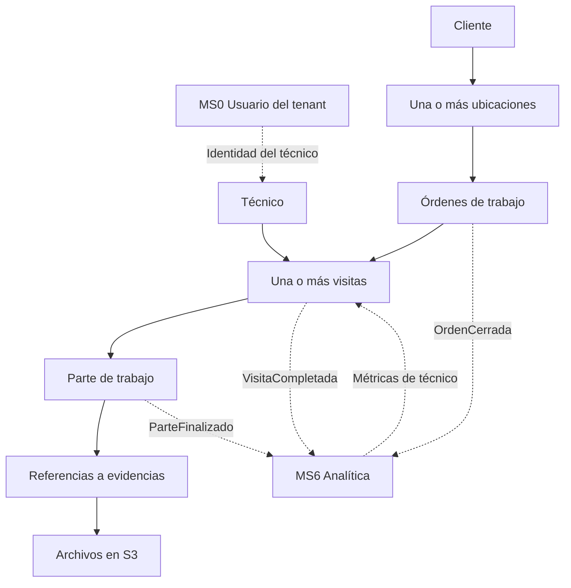

Este diagrama representa relaciones del negocio. En DynamoDB no se convierte automáticamente en claves foráneas entre servicios. Cada API debe comprobar que las referencias que acepta existen y pertenecen al tenant autorizado.

## 8. Conexiones y contratos entre componentes

### 8.1. Quién se comunica con quién

| Origen | Destino | Motivo | Forma propuesta |
|---|---|---|---|
| Frontend | API Gateway | Solicitar operaciones y consultar datos. | HTTPS con identidad validable. |
| Frontend | MS0 Usuarios | Login y consulta de perfil. | HTTPS por rutas de autenticación y perfil. |
| API Gateway / autorizador | MS0 Usuarios | Validar sesión, identidad, tenant y rol. | Token verificable y contexto confiable. |
| API Gateway | Autorizador | Comprobar acceso a la ruta. | Mecanismo de autorización. |
| API Gateway | Servicio correspondiente | Ejecutar la operación solicitada. | Invocación Lambda. |
| Órdenes | Clientes | Validar cliente y ubicación. | Consulta autenticada a su API. |
| Agenda | Técnicos | Validar especialidad, jornada y ausencia. | Consulta autenticada a su API. |
| Agenda | Órdenes | Verificar la orden y su situación. | Consulta autenticada a su API. |
| Partes | Agenda | Verificar visita, técnico y estado. | Consulta autenticada a su API. |
| Partes | S3 | Autorizar, verificar y consultar archivos. | Operaciones limitadas al objeto permitido. |
| Navegador | S3 | Cargar o descargar un archivo autorizado. | URL temporal emitida por el backend. |
| Partes | Agenda y Órdenes | Informar que se finalizó un parte. | Evento por SNS y SQS. |
| Agenda | Órdenes | Informar programación, cancelación o terminación. | Eventos por SNS y SQS. |
| Órdenes | Agenda | Bloquear nuevas visitas antes de cerrar o cancelar. | Comando interno autenticado e idempotente. |
| Agenda | Analítica | Consultar métricas de técnico para sugerir asignación óptima. | Consulta autenticada a su API. |
| Analítica | — | Solo lectura de eventos; no escribe en otros servicios. | Consumidor de cola SQS propia. |

**Regla de propiedad:** cada servicio escribe en sus tablas. Las llamadas internas también deben autenticar al emisor y conservar el contexto de empresa.

### 8.2. Solicitud y evento son cosas diferentes

Una **solicitud** pide hacer algo: “reserva esta visita”. La respuesta permite saber si se consiguió.

Un **evento** informa algo que ya ocurrió: “esta visita fue programada”. Los destinatarios actualizan su propia información cuando lo procesan.

El usuario espera una confirmación al crear una orden o reservar un horario. Las actualizaciones derivadas en otros servicios pueden tardar un momento; la interfaz debe mostrar ese estado con claridad.

### 8.3. Rutas iniciales sugeridas

Las rutas son contratos propuestos, no endpoints ya desplegados. Los nombres de etapa o dominio se definirán al implementar.

| Servicio | Método y ruta | Uso |
|---|---|---|
| Usuarios | `POST /auth/login` | Autenticar con tenant/cuenta y contraseña; entregar token de duración limitada. |
| Usuarios | `POST /usuarios` | Alta de usuario en el propio tenant; requiere administración autorizada. |
| Usuarios | `GET /usuarios` | Listar usuarios del tenant con paginación. |
| Usuarios | `GET /usuarios/me` | Consultar identidad y rol autenticados. |
| Usuarios | `PATCH /usuarios/{usuario_id}` | Cambiar rol o estado con autorización. |
| Clientes | `POST /clientes` | Registrar cliente. |
| Clientes | `GET /clientes` | Listar y buscar con paginación. |
| Clientes | `GET /clientes/{cliente_id}` | Consultar detalle. |
| Clientes | `POST /clientes/{cliente_id}/ubicaciones` | Agregar ubicación. |
| Técnicos | `POST /tecnicos` | Registrar técnico. |
| Técnicos | `GET /tecnicos` | Listar personal. |
| Técnicos | `PUT /tecnicos/{tecnico_id}/jornadas/{fecha}` | Definir jornada. |
| Técnicos | `GET /tecnicos/{tecnico_id}/jornadas` | Consultar rango de trabajo. |
| Órdenes | `POST /ordenes` | Crear orden. |
| Órdenes | `GET /ordenes` | Consultar por estado y otros filtros permitidos. |
| Órdenes | `GET /ordenes/{orden_id}` | Consultar detalle. |
| Órdenes | `POST /ordenes/{orden_id}/cerrar` | Solicitar cierre. |
| Órdenes | `POST /ordenes/{orden_id}/cancelar` | Cancelar bajo las reglas del MVP. |
| Agenda | `GET /disponibilidad` | Consultar opciones por técnico y fecha. |
| Agenda | `POST /visitas` | Programar visita. |
| Agenda | `GET /visitas` | Listar agenda con filtros y paginación. |
| Agenda | `POST /visitas/{visita_id}/reprogramar` | Cambiar horario o técnico. |
| Agenda | `POST /visitas/{visita_id}/iniciar` | Iniciar atención. |
| Agenda | `POST /visitas/{visita_id}/cancelar` | Cancelar visita pendiente. |
| Partes | `POST /visitas/{visita_id}/partes` | Crear borrador. |
| Partes | `POST /partes/{parte_id}/evidencias` | Solicitar una carga autorizada. |
| Partes | `POST /evidencias/{evidencia_id}/confirmar` | Confirmar archivo cargado. |
| Partes | `POST /partes/{parte_id}/finalizar` | Finalizar parte y generar evento. |
| Partes | `GET /partes/{parte_id}` | Consultar informe y evidencias autorizadas. |
| Analítica | `GET /analitica/tecnicos/{tecnico_id}` | Métricas históricas de un técnico (uso interno de MS4 para enrutamiento). |
| Analítica | `GET /analitica/tecnicos` | Ranking de técnicos por carga y rendimiento del tenant. |
| Analítica | `GET /analitica/dashboard` | Métricas agregadas del tenant: órdenes por estado, tendencias, tiempos. |

Además existirán operaciones internas, por ejemplo bloquear la agenda de una orden. No se expondrán como acciones generales para cualquier usuario.

Las rutas de creación aceptarán un identificador de solicitud. Si se repite la misma operación por doble clic o reintento, el backend podrá devolver el resultado ya creado. Los errores distinguirán entrada inválida, falta de acceso, recurso inexistente y conflicto de estado u horario.

## 9. Identidad, permisos y separación entre empresas

### 9.1. Decisión de autenticación revisada según el docente

La arquitectura conserva **API Gateway + autorizador Lambda**, pero añade **MS0 Usuarios y acceso**. El profesor explicó que los usuarios deben manejarse como un microservicio multitenant [F16]. El Taller Serverless 1 implementa alta de usuario, login, tokens con expiración y acceso protegido, y advierte que **Cognito no está disponible en el entorno AWS Academy empleado en ese taller** [F17].

**Diseño propuesto para el entorno académico:** implementar MS0 con Python, Lambda y DynamoDB, adaptando el ejemplo del taller. El login valida credenciales de un usuario perteneciente a una empresa determinada. El autorizador comprueba el token y obtiene un contexto confiable `usuario_id + tenant_id + rol`, que las APIs utilizan para filtrar y autorizar. El mecanismo concreto del token (opaco con sesión en DynamoDB o firmado y verificable) se fija antes de programar; no se aceptan tokens de ejemplo sin validación real. Al desplegar, se emplearán hashing adecuado de contraseñas, expiración, permisos de administración y registros sin datos sensibles.

**Cognito no es una dependencia obligatoria del plan:** solo se consideraría si la cuenta efectiva del curso lo permite. La validación multitenant en el backend sigue siendo necesaria incluso si se usara un proveedor administrado.

**Prueba obligatoria de la arquitectura:** un usuario de ClimaLima puede ver solo sus clientes y órdenes, mientras un usuario de FríoSur ve sus registros propios. La aplicación y el backend rechazan el intento de leer, modificar o enumerar usuarios y recursos de la otra empresa.

### Diagrama 5. Cómo se determina la empresa autorizada

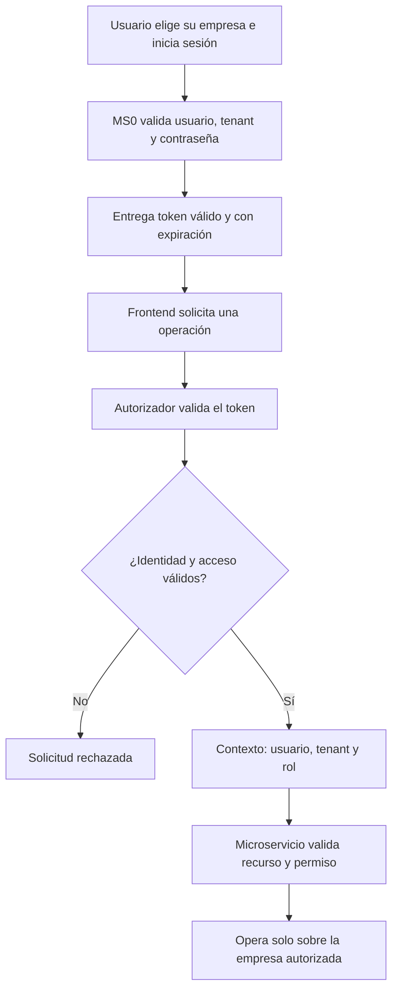

### 9.2. Reglas que deben aplicarse en todo el backend

1. El tenant procede de información verificada y administrada por MS0 / autorizador, nunca de un `tenant_id` libre incluido en la solicitud.
2. Los usuarios normales no pueden asignarse otro tenant ni elevar su rol; ni siquiera un administrador puede administrar usuarios fuera de su tenant.
3. Conocer el ID de una orden de otra empresa no permite leerla ni modificarla.
4. Un cliente, técnico, visita y parte relacionados deben pertenecer al mismo tenant.
5. Las consultas y sus índices incluyen el ámbito de empresa.
6. Las credenciales de AWS nunca se entregan al navegador.
7. Los archivos de S3 son privados y requieren autorización para emitir enlaces temporales.
8. Los eventos incluyen el tenant y solo pueden ser publicados por componentes autorizados.
9. Cada rol Lambda recibe acceso a las tablas, colas, tema y objetos que necesita.

**Prueba esencial:** entrar como FríoSur e intentar consultar una orden de ClimaLima, incluso alterando manualmente el identificador. El backend debe rechazarla. Cambiar lo visible en una pantalla no constituye por sí solo aislamiento.

## 10. Diseño inicial de los datos

### 10.1. Criterio de almacenamiento

Cada servicio tendrá su propia tabla o conjunto de tablas DynamoDB. Dentro de ellas, los registros incorporan el tenant. DynamoDB se organiza por tablas y admite distintas estrategias de almacenamiento multitenant. [F9]

Para el volumen académico se propone comenzar con:

- **PK:** clave de partición que incorpora la empresa.
- **SK:** clave de ordenamiento que identifica el tipo de registro y su ID.
- **entity_type:** tipo de registro, para distinguir clientes, jornadas, visitas, etc.
- **version:** número que cambia al modificar un recurso, cuando sea necesario controlar actualizaciones simultáneas.

Un ejemplo de PK es `TENANT#CLIMALIMA`; un ejemplo de SK es `ORDEN#OT-001`.

Esta es una base académica sencilla. Si un tenant concentrara mucho tráfico, se revisaría la distribución de sus claves; no se presenta este esquema inicial como una solución universal para cualquier escala.

Las fechas de instantes se almacenarán en UTC. La interfaz mostrará horarios con la zona **America/Lima**. Por ejemplo, `2026-11-10T15:00:00Z` representa las 10:00 de Lima.

### 10.2. MS0: usuarios y sesiones multitenant

**Tabla propia sugerida:** `t_usuarios` (o nombre equivalente por stage). Se recomienda usar `PK = TENANT#<tenant_id>` y `SK = USUARIO#<usuario_id>`, con un índice de búsqueda por identificador de login limitado al mismo tenant. Las sesiones pueden residir en otra tabla exclusiva del MS0 con vencimiento.

```json
{
  "PK": "TENANT#CLIMALIMA",
  "SK": "USUARIO#USR-001",
  "entity_type": "USUARIO",
  "tenant_id": "CLIMALIMA",
  "usuario_id": "USR-001",
  "email": "coordinador001@example.com",
  "rol": "COORDINADOR",
  "estado": "ACTIVO",
  "password_hash": "<hash_derivado_en_backend>",
  "creado_en": "2026-10-29T15:00:00Z"
}
```

**Consultas:** obtener usuario por clave dentro del tenant; autenticar usuario del tenant; listar usuarios paginados del propio tenant; verificar rol y estado. El ejemplo es ilustrativo: el `password_hash` real nunca debe registrarse ni aparecer en respuestas a clientes.

**Datos de prueba:** separar las cuentas reales de demostración, que sí tendrán credenciales válidas, de cualquier volumen de usuarios ficticios **inactivos y sin credenciales de acceso** que eventualmente pida el profesor. La carga masiva de perfiles no equivale a crear miles de cuentas listas para iniciar sesión. Si se necesitan 30 000 registros para MS0, obtener la confirmación académica antes de ejecutar esa carga.


### 10.3. MS1: cliente y ubicación

```json
{
  "PK": "TENANT#CLIMALIMA",
  "SK": "CLIENTE#CLI-001",
  "entity_type": "CLIENTE",
  "tenant_id": "CLIMALIMA",
  "cliente_id": "CLI-001",
  "nombre": "Comercial López",
  "telefono": "CONTACTO_FICTICIO_001",
  "correo": "cliente001@example.com",
  "activo": true
}
```

```json
{
  "PK": "TENANT#CLIMALIMA",
  "SK": "UBICACION#CLI-001#LOC-001",
  "entity_type": "UBICACION",
  "tenant_id": "CLIMALIMA",
  "cliente_id": "CLI-001",
  "ubicacion_id": "LOC-001",
  "nombre": "Oficina principal",
  "direccion": "Dirección ficticia de demostración",
  "distrito": "Miraflores",
  "referencia": "Piso 3"
}
```

**Consultas necesarias:** listar clientes del tenant; obtener cliente por ID; listar ubicaciones de un cliente. La búsqueda por nombre se definirá de forma acotada para el MVP, por ejemplo por nombre normalizado y prefijo, evitando prometer búsqueda libre de texto sin diseñarla.

### 10.4. MS2: técnico y jornada

```json
{
  "PK": "TENANT#CLIMALIMA",
  "SK": "TECNICO#TEC-001",
  "entity_type": "TECNICO",
  "tenant_id": "CLIMALIMA",
  "tecnico_id": "TEC-001",
  "usuario_id": "USR-TEC-001",
  "nombre": "Carlos",
  "especialidades": ["MANTENIMIENTO", "REPARACION"],
  "activo": true
}
```

```json
{
  "PK": "TENANT#CLIMALIMA",
  "SK": "JORNADA#TEC-001#2026-11-10",
  "entity_type": "JORNADA",
  "tenant_id": "CLIMALIMA",
  "tecnico_id": "TEC-001",
  "fecha": "2026-11-10",
  "zona_horaria": "America/Lima",
  "intervalos": [
    {"inicio": "08:00", "fin": "12:00"},
    {"inicio": "13:00", "fin": "17:00"}
  ]
}
```

**Consultas necesarias:** técnicos activos; perfil y especialidades; jornadas y ausencias de un técnico en un rango de fechas.

### 10.5. MS3: orden

```json
{
  "PK": "TENANT#CLIMALIMA",
  "SK": "ORDEN#OT-001",
  "entity_type": "ORDEN",
  "tenant_id": "CLIMALIMA",
  "orden_id": "OT-001",
  "cliente_id": "CLI-001",
  "ubicacion_id": "LOC-001",
  "tipo_servicio": "REPARACION",
  "descripcion": "El aire acondicionado no enfría",
  "prioridad": "ALTA",
  "estado": "ABIERTA",
  "version": 1,
  "creada_en": "2026-11-09T15:00:00Z"
}
```

**Consultas necesarias:** orden por ID; órdenes por estado; órdenes de un cliente; historial de la orden.

Para listar por estado, un índice podría usar `TENANT#CLIMALIMA#ESTADO#ABIERTA` como clave de agrupación y la fecha de creación más el ID como ordenamiento.

### 10.6. MS4: visita, bloques y control de la orden

```json
{
  "PK": "TENANT#CLIMALIMA",
  "SK": "VISITA#VIS-001",
  "entity_type": "VISITA",
  "tenant_id": "CLIMALIMA",
  "visita_id": "VIS-001",
  "orden_id": "OT-001",
  "tecnico_id": "TEC-001",
  "inicio": "2026-11-10T15:00:00Z",
  "fin": "2026-11-10T16:00:00Z",
  "estado": "PROGRAMADA",
  "version": 1
}
```

También se guardan registros auxiliares de reserva, con una clave única por tenant, técnico e inicio del bloque. Por ejemplo, el bloque de las 10:00 de Lima puede identificarse con:

```text
PK = TENANT#CLIMALIMA
SK = BLOQUE#TEC-001#2026-11-10T15:00:00Z
```

La reserva guarda el `visita_id` propietario. Para 10:00–11:00 se reservan los bloques 10:00 y 10:30. El extremo final no se incluye: otra visita puede comenzar a las 11:00 si cumple las demás reglas.

Agenda mantiene además este control:

```json
{
  "PK": "TENANT#CLIMALIMA",
  "SK": "CONTROL_ORDEN#OT-001",
  "entity_type": "CONTROL_ORDEN",
  "orden_id": "OT-001",
  "acepta_programaciones": true,
  "visitas_activas": 1,
  "version": 2
}
```

El contador incluye visitas programadas o en atención. Se actualiza en la misma transacción que crea o termina la visita. Este registro permite coordinar el cierre sin que otra persona reserve una nueva visita al mismo tiempo.

**Inicialización del control:** después de validar la orden, Agenda crea este registro de forma idempotente antes de la primera reserva o bloqueo, con cero visitas activas. Una creación repetida no sobrescribe ni reabre un control existente. Esto también permite bloquear una orden que nunca tuvo visitas. El control conserva el ID y tipo de operación de bloqueo para reconocer sus reintentos.

**Consultas necesarias:** agenda de un técnico en un rango; visitas de una orden; visita por ID; bloques de un técnico y fecha.

### 10.7. MS5: parte y evidencias

```json
{
  "PK": "TENANT#CLIMALIMA",
  "SK": "PARTE#PAR-001",
  "entity_type": "PARTE",
  "tenant_id": "CLIMALIMA",
  "parte_id": "PAR-001",
  "orden_id": "OT-001",
  "visita_id": "VIS-001",
  "tecnico_id": "TEC-001",
  "estado": "FINALIZADO",
  "diagnostico": "Filtro obstruido",
  "tareas": ["Limpieza de filtro", "Prueba de funcionamiento"],
  "resultado": "RESUELTO",
  "evidencias": [
    {
      "evidencia_id": "EVI-001",
      "object_key": "tenants/CLIMALIMA/ordenes/OT-001/visitas/VIS-001/EVI-001.jpg",
      "estado": "CONFIRMADA",
      "content_type": "image/jpeg"
    }
  ],
  "version": 1,
  "finalizado_en": "2026-11-10T16:05:00Z"
}
```

**Consultas necesarias:** parte de una visita; partes de una orden; evidencias autorizadas de un parte.

La ruta del archivo no concede acceso por sí misma. El backend autoriza la operación y emite el enlace temporal correspondiente. El ejemplo representa un archivo que ya fue confirmado; el generador de datos no debe crear referencias falsas como si fueran archivos disponibles.

### 10.8. MS6: métricas de analítica

**Tabla propia:** `t_analitica`. Dos tipos de registro principales: métricas por técnico y métricas por tenant.

```json
{
  "PK": "TENANT#CLIMALIMA",
  "SK": "TECNICO#TEC-001#METRICAS",
  "entity_type": "METRICAS_TECNICO",
  "tenant_id": "CLIMALIMA",
  "tecnico_id": "TEC-001",
  "visitas_completadas_total": 142,
  "visitas_completadas_hoy": 3,
  "revisitas_generadas": 8,
  "tasa_resolucion_primer_intento": 0.94,
  "tiempo_promedio_atencion_min": 52,
  "ultima_actualizacion": "2026-11-10T16:05:00Z"
}
```

```json
{
  "PK": "TENANT#CLIMALIMA",
  "SK": "DASHBOARD#2026-11",
  "entity_type": "SNAPSHOT_TENANT",
  "tenant_id": "CLIMALIMA",
  "periodo": "2026-11",
  "ordenes_abiertas": 24,
  "ordenes_cerradas": 187,
  "ordenes_canceladas": 6,
  "visitas_programadas": 31,
  "visitas_completadas": 201,
  "tiempo_promedio_cierre_dias": 2.3,
  "actualizado_en": "2026-11-10T16:05:00Z"
}
```

**Consultas necesarias:** métricas de un técnico por tenant (llamada interna de MS4); ranking de técnicos ordenado por carga del día y tasa de resolución; snapshot del tenant para el dashboard del coordinador.

Los contadores se actualizan de forma incremental al procesar cada evento — no se recalculan desde cero. Si llega un evento duplicado, el procesador verifica el INBOX y no vuelve a incrementar.

### 10.9. Índices y paginación

Cada responsable debe documentar las consultas de su servicio antes de cerrar las claves e índices. Los índices por técnico, estado, cliente u orden deben conservar el tenant en sus claves.

Las listas se consultan por páginas. Una pantalla no debe intentar descargar los 30 000 registros al abrirse.

Los registros de analítica son de solo lectura desde el frontend. MS4 los consulta internamente sin exponerlos al navegador directamente.

Los índices sirven para encontrar registros. Las condiciones críticas de reserva, cierre o versión se verifican contra los registros de control y las escrituras condicionadas, no únicamente contra una lista que se mostró antes al usuario.

## 11. Flujos funcionales paso a paso

Los diagramas de esta sección omiten API Gateway y el autorizador cuando no son el punto del ejemplo. Todas las operaciones siguen pasando por el control de acceso correspondiente.

### 11.0. Flujo previo — Iniciar sesión en una empresa (MS0)

1. El usuario introduce el identificador de empresa y sus credenciales.
2. MS0 verifica que la cuenta existe dentro de ese tenant, está activa y tiene el rol correspondiente.
3. Se entrega un token con expiración y el frontend lo envía al llamar a APIs protegidas.
4. El autorizador valida el token y crea el contexto `usuario_id`, `tenant_id`, `rol`.
5. MS1–MS5 consultan y modifican datos **solo** con ese contexto; no aceptan un tenant distinto suministrado desde el navegador.

**Resultado visible:** ClimaLima y FríoSur pueden iniciar sesión con cuentas propias sin ver información mutua.


### 11.1. Flujo A — Crear una orden

**Actor:** coordinador o administrador.

1. Selecciona un cliente y una ubicación.
2. Escribe el problema, tipo de servicio y prioridad.
3. El frontend envía la solicitud con una clave que identifica ese intento de creación.
4. Órdenes obtiene el tenant autorizado y comprueba los campos.
5. Consulta a Clientes para validar cliente y ubicación.
6. Guarda la orden como `ABIERTA`.
7. Devuelve el ID de la orden y muestra su detalle.

### Diagrama 6. Creación de orden

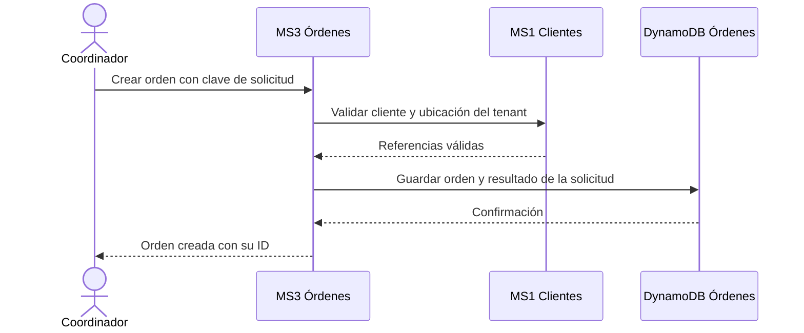

Si el usuario repite la misma solicitud, el backend devuelve la orden ya creada. Si la misma clave llega con un contenido diferente, se rechaza el uso inconsistente de esa clave.

**Resultado visible:** existe una orden abierta. Todavía puede no tener visitas.

### 11.2. Flujo B — Consultar y reservar un horario

**Actor:** coordinador.

1. Abre una orden y elige un técnico o especialidad.
2. Agenda consulta jornada y ausencias en Técnicos.
3. Combina esa información con sus reservas existentes.
4. Muestra opciones de horario.
5. El coordinador selecciona una opción.
6. Al guardar, Agenda vuelve a validar orden, técnico y horario.
7. Una transacción crea la visita, reserva los bloques, incrementa el contador de visitas activas y guarda el evento pendiente.
8. Si algún bloque está ocupado o la orden ya no admite visitas, toda la reserva falla.
9. Si se confirma, se informa al usuario y se publicará `VisitaProgramada`.

### Diagrama 7. Reserva de visita

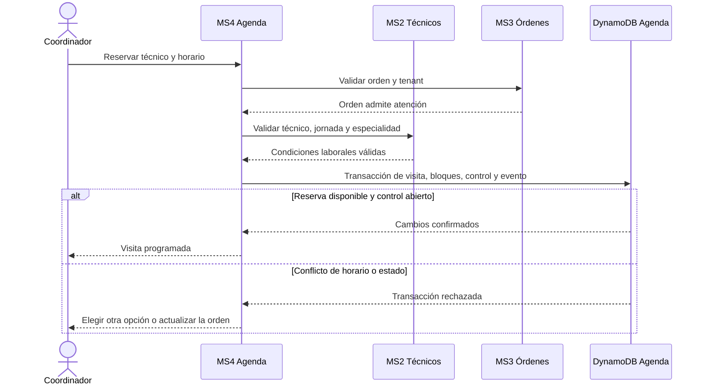

**Consultar disponibilidad y reservar son operaciones diferentes.** Dos personas pueden ver un mismo horario libre. La escritura condicionada decide cuál reserva puede confirmarse.

DynamoDB permite agrupar escrituras y condiciones en una transacción que se aplica completa o falla completa. Esta capacidad se utiliza dentro del almacenamiento de Agenda. [F10]

Si se incorpora tiempo de traslado, debe formar parte del intervalo bloqueado. Para el MVP puede utilizarse un margen configurable, sin construir optimización de rutas.

### 11.3. Flujo C — Reprogramar una visita

**Actor:** coordinador. **Estado permitido inicialmente:** `PROGRAMADA`.

1. Abre la visita y solicita el nuevo horario o técnico.
2. Agenda valida las nuevas condiciones.
3. Compara la versión actual con la que el usuario editó.
4. Calcula los bloques nuevos, los que se mantienen y los que deben liberarse.
5. En una misma transacción, reserva los bloques nuevos, modifica la visita, libera los antiguos que ya no necesita y registra el evento.
6. Publica `VisitaReprogramada`.

### Diagrama 8. Reprogramación sin perder la reserva anterior

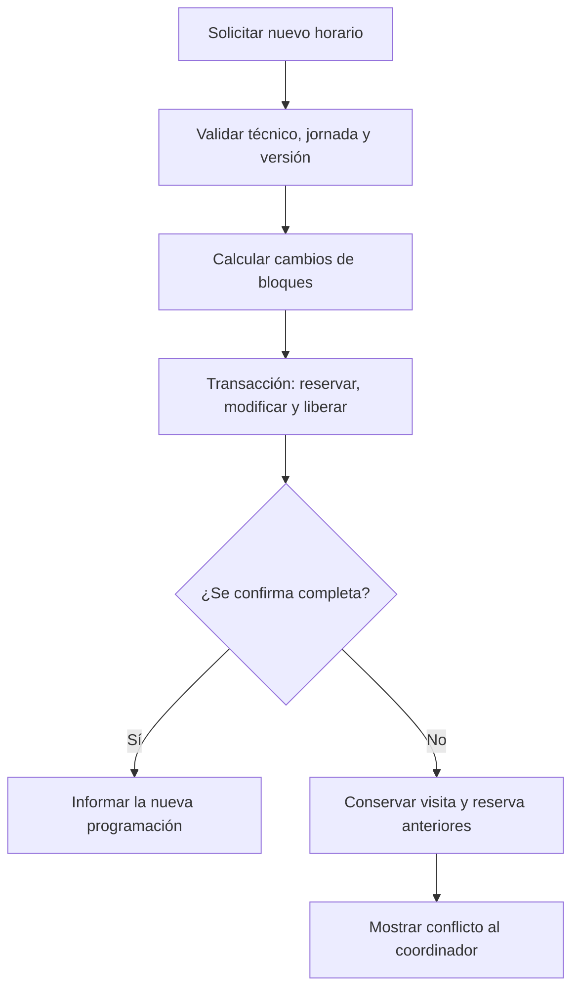

La reserva, la modificación de la visita y la liberación forman parte de **una sola transacción**. No se libera primero la cita antigua para después intentar conseguir la nueva.

Los bloques compartidos entre el horario anterior y el nuevo se conservan. No deben interpretarse como una reserva ajena.

### 11.4. Flujo D — Cancelar una visita

**Actor:** coordinador. **Estado permitido inicialmente:** `PROGRAMADA`.

Agenda comprueba tenant, permiso y versión. Luego cambia la visita a `CANCELADA`, libera sus bloques, disminuye el contador de visitas activas y registra `VisitaCancelada`, dentro de una transacción.

Si la operación ya fue aplicada, repetirla devuelve el resultado existente. No vuelve a disminuir el contador.

**Cancelar una visita mantiene la orden disponible para seguimiento**, salvo que el coordinador solicite también cancelar la orden bajo sus propias reglas.

### 11.5. Flujo E — Iniciar la atención

**Actor:** técnico asignado.

El técnico abre “Mis visitas”, selecciona la atención y presiona “Iniciar”. Agenda comprueba asignación, tenant y estado, y cambia la visita a `EN_ATENCION`.

Desde ese momento, el flujo normal no permite reasignar o cancelar la visita. Una incidencia requiere intervención del coordinador. Esta regla evita que un técnico complete un informe sobre una asignación que cambió mientras trabajaba.

### Diagrama 9. Estados básicos de una visita

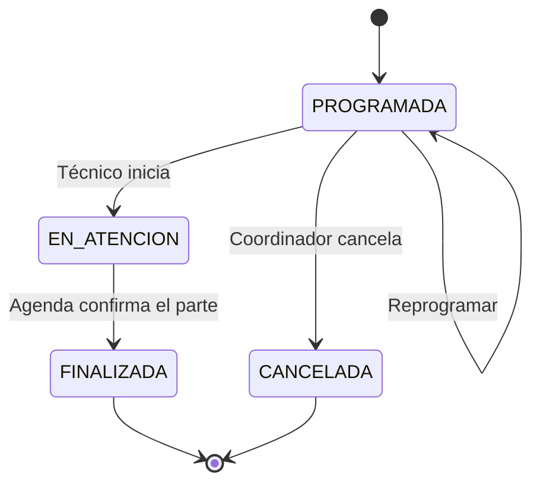

`FINALIZADA` significa que terminó ese intento de atención. El resultado del parte indica si el problema se resolvió, requiere otra visita o no pudo atenderse.

### 11.6. Flujo F — Subir una evidencia

**Actor:** técnico asignado a una visita en atención.

1. Elige una foto en el formulario del parte.
2. Partes comprueba identidad, tenant, visita y asignación.
3. Genera una clave de objeto nueva dentro del espacio de esa empresa.
4. Entrega una URL temporal de carga.
5. El navegador sube el archivo directamente a S3.
6. El frontend solicita confirmar la evidencia.
7. Partes comprueba la existencia del objeto y las propiedades esperadas.
8. Guarda o actualiza sus metadatos como `CONFIRMADA`.

### Diagrama 10. Archivo en S3 y metadatos en Partes

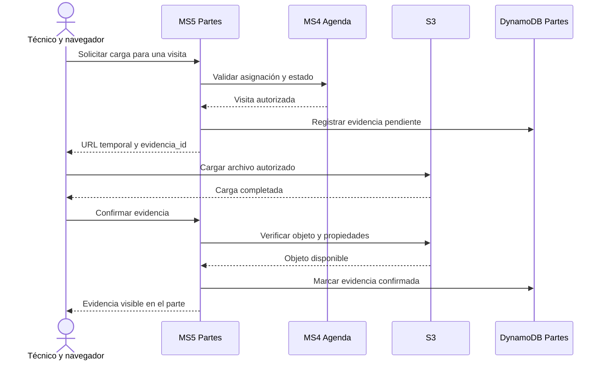

Las URLs prefirmadas permiten cargar objetos sin entregar credenciales de AWS al navegador. [F11] En la propuesta, la autorización se comprueba antes de emitirlas y la clave es generada por el backend.

Como límite inicial del producto se propone admitir JPEG y PNG de hasta 5 MB por imagen. La validación de tamaño y tipo debe implementarse en el mecanismo de carga y comprobarse al confirmar; no se considera suficiente una comprobación visual del formulario.

Para consultar una evidencia, el backend vuelve a verificar el acceso y emite un enlace de lectura temporal. Si la carga falla, el archivo se mantiene pendiente y puede reintentarse.

### 11.7. Flujo G — Finalizar el parte y actualizar otros servicios

**Actor:** técnico.

1. Completa diagnóstico, tareas y resultado.
2. Partes valida que las evidencias referenciadas estén confirmadas.
3. Verifica la visita y la asignación del técnico.
4. En una transacción propia, guarda el parte final, el evento pendiente y una marca única por tenant y visita, condicionada a que no exista. Así dos solicitudes simultáneas no pueden finalizar partes distintos para la misma visita.
5. La publicadora envía `ParteFinalizado` a SNS.
6. Agenda recibe el evento y valida que corresponda a la visita y asignación vigentes.
7. Agenda cambia la visita a `FINALIZADA`, actualiza su control y genera `VisitaCompletada`.
8. Órdenes registra el parte en su historial y procesa la confirmación de Agenda.
9. Si la atención resolvió el trabajo y no hay pendientes conocidos, presenta la orden para revisión. Si requiere seguimiento, lo muestra como pendiente.

**La pantalla puede mostrar “Parte guardado; actualizando la orden”** mientras se procesan los eventos. Después vuelve a consultar el estado.

Reintentar la finalización del mismo parte devuelve su resultado existente. Intentar finalizar otro parte para esa visita produce un conflicto. La unicidad no depende solamente de consultar antes si había un parte.

Órdenes no debe cerrar automáticamente al recibir el primer evento: los consumidores de Agenda y Órdenes se ejecutan de forma independiente y pueden terminar en distinto orden.

### 11.8. Flujo H — Cerrar una orden sin aceptar otra visita simultáneamente

**Actor:** coordinador.

Regla de negocio: el coordinador confirma que el trabajo pendiente identificado en los partes vigentes está resuelto, las finalizaciones correspondientes fueron aceptadas por Agenda y no quedan visitas activas. Un resultado `RESUELTO` histórico, por sí solo, no habilita el cierre.

1. Órdenes valida la solicitud y registra `CIERRE_EN_PROCESO`, asociada a un ID de operación.
2. Solicita a Agenda bloquear la programación de esa orden.
3. Agenda modifica su registro de control **solo si visitas_activas es cero**.
4. Desde ese momento, las transacciones de nuevas reservas rechazan la orden.
5. Agenda confirma el bloqueo.
6. Órdenes registra `CERRADA`.

### Diagrama 11. Coordinación del cierre

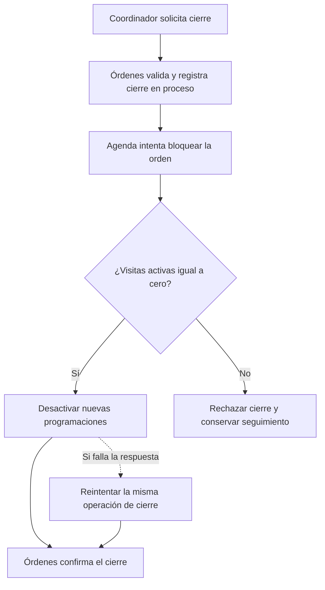

La misma transacción que crea una visita exige que el control siga abierto e incrementa el contador. Por eso, una reserva concurrente y el bloqueo de cierre no pueden ignorarse entre sí.

Si la comunicación falla después de bloquear la agenda, se mantiene una operación pendiente y se reintenta con el mismo ID. No se declara éxito ni se reabre automáticamente sin comprobar qué pasos se aplicaron.

Si Agenda rechaza expresamente el cierre porque quedan visitas activas, Órdenes registra ese rechazo y recupera el estado operativo correspondiente a las visitas vigentes. No restaura indiscriminadamente un estado antiguo si llegaron otros eventos. Si el resultado es desconocido por una falla de comunicación, conserva el cierre pendiente y reintenta.

Este procedimiento coordina dos servicios; **no es una única transacción entre todas sus bases**. Las operaciones deben ser idempotentes y recuperables.

### 11.9. Flujo I — Cancelar una orden

Para el MVP, la cancelación de la orden solo se permite cuando no tiene visitas programadas ni en atención. El coordinador primero cancela las visitas pendientes o resuelve las que están en ejecución.

Órdenes utiliza el mismo control de Agenda para bloquear nuevas programaciones y, tras la confirmación, registra `CANCELADA`. El historial y los partes existentes se conservan.

La cancelación masiva automática de todas las visitas puede implementarse más adelante; no forma parte del alcance mínimo propuesto.

### 11.10. Estados de la orden

| Estado propuesto | Significado | Qué permite avanzar |
|---|---|---|
| ABIERTA | Solicitud registrada. | Programar una visita. |
| PROGRAMADA | Tiene una atención planificada. | Iniciar o reprogramar. |
| EN_ATENCION | Hay una atención en ejecución. | Registrar su resultado. |
| REQUIERE_REVISITA | Queda trabajo por resolver. | Programar seguimiento. |
| PENDIENTE_DE_CIERRE | Existe una atención resuelta y confirmada, pendiente de revisión. | Verificar las visitas y solicitar cierre. |
| CIERRE_EN_PROCESO | Se está coordinando el bloqueo y cierre. | Completar o recuperar la operación. |
| CERRADA | El coordinador confirmó la terminación del trabajo. | Consultar historial. |
| CANCELADA | El trabajo fue cancelado bajo las reglas establecidas. | Consultar historial. |

El estado general debe derivarse de las visitas y resultados vigentes. Un evento atrasado no debe reemplazar una situación más reciente sin comprobar la versión y la transición.

## 12. Eventos, reintentos y recuperación

### 12.1. Catálogo inicial de eventos

| Evento | Productor | Consumidor | Efecto |
|---|---|---|---|
| VisitaProgramada | Agenda | Órdenes | Registrar la atención planificada. |
| VisitaReprogramada | Agenda | Órdenes | Actualizar su resumen e historial. |
| VisitaIniciada | Agenda | Órdenes | Reflejar que hay atención en curso. |
| VisitaCancelada | Agenda | Órdenes | Registrar la cancelación de esa visita. |
| ParteFinalizado | Partes | Agenda | Confirmar la terminación de la visita si la transición es válida. |
| ParteFinalizado | Partes | Órdenes | Registrar el resultado informado y la referencia al parte. |
| VisitaCompletada | Agenda | Órdenes | Confirmar el estado terminal y resultado de la visita. |
| VisitaCompletada | Agenda | Analítica | Actualizar contadores del técnico: visitas del día, tiempo de atención y tasa de resolución. |
| ParteFinalizado | Partes | Analítica | Registrar resultado del parte para calcular tasa de resolución en primer intento. |
| OrdenCerrada | Órdenes | Analítica | Actualizar snapshot del tenant: órdenes cerradas y tiempo promedio de cierre. |

`VisitaCompletada` representa la finalización operativa del intento de atención. Su resultado puede ser `RESUELTO`, `REQUIERE_REVISITA` o `NO_ATENDIDO`; el nombre del evento no implica que toda la orden esté resuelta.

### 12.2. Formato de un evento

```json
{
  "event_id": "EVT-001",
  "event_type": "ParteFinalizado",
  "schema_version": 1,
  "tenant_id": "CLIMALIMA",
  "aggregate_type": "PARTE",
  "aggregate_id": "PAR-001",
  "aggregate_version": 1,
  "occurred_at": "2026-11-10T16:05:00Z",
  "correlation_id": "ATENCION-VIS-001",
  "data": {
    "orden_id": "OT-001",
    "visita_id": "VIS-001",
    "parte_id": "PAR-001",
    "tecnico_id": "TEC-001",
    "visita_version_observada": 2,
    "resultado": "RESUELTO"
  }
}
```

- **event_id:** identifica el mismo hecho, incluso si se vuelve a enviar.
- **schema_version:** versión del formato del mensaje.
- **aggregate_version:** versión del recurso que originó el evento.
- **correlation_id:** permite relacionar registros de una misma atención.
- **visita_version_observada:** ayuda a detectar una asignación o estado que cambió.

Las versiones de una visita y de un parte son independientes. No se comparan entre sí como si fueran un único contador global.

### 12.3. Dos colas para dos consumidores

Se propone un tema SNS de eventos FSM y dos colas de negocio:

| Cola | Mensajes que recibe | Procesador |
|---|---|---|
| Cola de Agenda | ParteFinalizado. | Lambda del servicio Agenda. |
| Cola de Órdenes | Eventos de Agenda y ParteFinalizado. | Lambda del servicio Órdenes. |
| Cola de Analítica | VisitaCompletada, ParteFinalizado y OrdenCerrada. | Lambda del servicio Analítica. |

Las suscripciones filtran por tipo de evento. Cada cola tiene su propia configuración de reintentos y una cola de errores.

Si dos funciones compiten por una sola cola, no se obtiene automáticamente una copia para cada área. Por eso se utilizan colas separadas para los consumidores que necesitan procesar el mismo hecho.

### 12.4. Guardar también el aviso pendiente

Guardar un parte y luego llamar a SNS son dos acciones diferentes. Para recuperar una falla entre ambas, el servicio guarda el cambio de negocio y un registro `OUTBOX` en una transacción de su propia base.

Ese registro conserva el evento pendiente. Una Lambda asociada a DynamoDB Streams publica los nuevos registros `OUTBOX` en SNS y marca su publicación. Streams permite activar funciones a partir de cambios en DynamoDB. [F12]

**Controles del publicador:**

- Procesar solo los registros de evento que correspondan; no convertir cada modificación de tabla en un evento público.
- Mantener el mismo event_id al reintentar.
- No generar nuevos avisos por actualizar una marca de publicación.
- Conservar los pendientes y ofrecer un procedimiento para reintentarlos.
- Detectar publicaciones que siguen pendientes; la recuperación no debe depender indefinidamente del historial temporal del stream.

Para el proyecto, un comando de recuperación que lea pendientes y los vuelva a publicar puede complementar el disparador. El procedimiento y sus permisos deben quedar documentados.

### 12.5. Procesar sin duplicar efectos

Lambda con SQS puede procesar un mensaje más de una vez. La aplicación debe soportar esa repetición. [F13]

Cada consumidor guarda en su propia base una marca `INBOX` con el event_id procesado. **La marca y el cambio de negocio se guardan juntos**, en una transacción.

Si llega otra vez el evento, el consumidor reconoce que ya aplicó el efecto. Por ejemplo, no vuelve a disminuir el contador de visitas activas.

Cuando se procesan mensajes por lotes, se deben informar correctamente los fallos parciales para reintentar los mensajes que fallaron. Si un mensaje supera los intentos previstos, pasa a la cola de errores para inspección y recuperación.

Los registros OUTBOX, INBOX, bloqueos y marcas técnicas **no se utilizarán para completar artificialmente el mínimo de datos de negocio**.

### 12.6. Qué hacer con eventos antiguos o incompatibles

El consumidor comprueba tipo, tenant, referencia, versión y transición permitida. Un evento de programación antiguo no puede reabrir una visita ya finalizada o una orden cerrada.

Si el evento es válido pero llega antes que otro dato necesario, se mantiene un estado pendiente o se vuelve a consultar la fuente autorizada. Si contradice una cancelación o asignación vigente, se registra el conflicto para revisión; no se fuerza el cambio.

## 13. Carga de datos ficticios

### 13.1. Qué exige el enunciado

La explicación oral señala **al menos 30 000 registros por microservicio repartidos en tres tenants**, aproximadamente 10 000 por tenant, y ordena no usar el API REST para la carga [F16]. Los cinco servicios FSM conservan un mínimo de **150 000 registros de negocio** en total. Si MS0 Usuarios también está sujeto al mínimo, el objetivo para seis microservicios sube a **180 000 registros**.

**Pendiente de confirmar con el profesor o asistente:** si los 30 000 registros aplican también a MS0. La transcripción no establece una excepción. Hasta aclararlo, se diseña el generador para poder alcanzar ambas alternativas, sin crear 30 000 cuentas activas inseguras. Tampoco se requieren 30 000 técnicos distintos ni 30 000 registros por tenant de cada microservicio: son 30 000 por servicio repartidos entre los tres tenants.

### 13.2. Plan de carga propuesto

| Servicio | Carga por tenant | Total para tres tenants |
|---|---|---:|
| Usuarios (MS0, **condicional**) | Hasta 10 000 perfiles ficticios **inactivos, sin credenciales activas**, si el docente confirma que cuentan. | Hasta 30 000 perfiles, más unas pocas cuentas activas de demo. |
| Clientes | 10 000 clientes, más sus ubicaciones. | Al menos 30 000 clientes; las ubicaciones se cuentan aparte. |
| Técnicos | 50 perfiles y 10 000 jornadas. | 30 150 registros de negocio. |
| Órdenes | 10 000 órdenes históricas cerradas y 20 no cerradas, en estado PROGRAMADA. | 30 060 órdenes. |
| Agenda | 10 000 visitas históricas finalizadas y 20 programadas. | 30 060 visitas. |
| Partes | 10 000 partes históricos finalizados. | 30 000 partes. |
| Analítica | Un registro de métricas por técnico (50 por tenant) + snapshots mensuales históricos hasta completar 10 000 registros por tenant. | 30 000 registros de analítica. |

Los seis servicios FSM producen **al menos 180 270 registros de negocio**, antes de añadir ubicaciones u otros registros. **Si se incluyen 30 000 perfiles en Usuarios, el total sería al menos 210 270**. Las cifras son metas de implementación; el volumen de Usuarios permanece sujeto a confirmación.

Para Técnicos: **50 técnicos × 200 jornadas = 10 000 jornadas por empresa**. Las fechas de las jornadas deben cubrir las atenciones históricas y futuras que se generen.

### 13.3. Procedimiento técnico de carga (aclaración explícita del profesor)

**La carga masiva NO utilizará API Gateway, Lambda ni el endpoint `POST` de ningún microservicio.** El profesor pidió expresamente un programa Python ejecutado en una máquina virtual que, mediante **boto3 y credenciales temporales válidas del entorno AWS Academy**, inserte directamente en DynamoDB [F16].

```text
MV de desarrollo / AWS Academy
  └── scripts/seed/cargar_datos.py
       └── boto3 (batch_writer por tabla; reintentos, lotes, conteos)
            ├── DynamoDB Usuarios (solo si aplica el volumen)
            ├── DynamoDB Clientes
            ├── DynamoDB Técnicos
            ├── DynamoDB Órdenes
            ├── DynamoDB Agenda
            ├── DynamoDB Partes
            └── DynamoDB Analítica
```

**Orden del generador:**

1. Definir los tres tenants y una semilla para reproducir la generación.
2. Preparar cuentas activas de demo mediante MS0. **Solo si se confirma el volumen**, insertar por boto3 usuarios ficticios inactivos sin credenciales utilizables.
3. Crear clientes y ubicaciones.
4. Crear técnicos, especialidades y jornadas, asociando solo los técnicos de demo a cuentas activas.
5. Crear órdenes asociadas a clientes y ubicaciones existentes.
6. Generar visitas con técnicos del mismo tenant y horarios compatibles.
7. Crear partes para las visitas históricas finalizadas.
8. Construir los bloques de las visitas programadas y los controles de Agenda, con contadores coherentes. Estos auxiliares no completan el mínimo de datos de negocio.
9. Preparar unas pocas atenciones de demo y producir el reporte por tabla, tenant y tipo de registro.

El script tendrá validación de `--stage`, control del entorno/credenciales, claves idempotentes y salida de conteos. Nunca almacenará llaves de acceso dentro del repositorio. Las operaciones de carga deben respetar las relaciones entre entidades y no activar flujos de negocio ni notificaciones reales sin control.

La mayor parte de los partes históricos puede existir sin fotografías. Para la demo se cargarán archivos reales mediante el flujo de S3.

Los casos de varias visitas se pueden preparar como registros adicionales de demostración. Al añadirlos, deben conservarse las relaciones y los conteos consistentes.

### 13.4. Evidencia de volumen

El generador debe producir un reporte por **servicio, tenant y tipo de entidad**. El conteo verificará todos los resultados paginados; no se tomará el tamaño de una primera página como el total.

Se distinguirán los registros de negocio de OUTBOX, INBOX, bloques de reserva y controles. Los totales declarados en el informe deben coincidir con la carga ejecutada.

En el reporte se indicarán la fecha de generación, la semilla o versión del generador y el entorno de destino. Se mostrará que la carga se ejecutó **directamente con boto3**, sin bombardear las APIs. Los datos serán ficticios y no dispararán comunicaciones reales a personas.

## 14. Pantallas y experiencia de uso

| Pantalla | Usuario principal | Contenido y acción clave |
|---|---|---|
| Inicio de sesión | Todos | Empresa + credenciales; autenticación por MS0. |
| Usuarios y roles | Administrador | Alta, listado, consulta y desactivación de usuarios de su propio tenant. |
| Panel | Administrador y coordinador | Órdenes por estado, próximas visitas y trabajo pendiente. |
| Clientes | Coordinador | Buscar, registrar y consultar ubicaciones. |
| Técnicos | Administrador y coordinador | Personal, especialidades, jornadas y ausencias. |
| Órdenes | Coordinador | Crear, filtrar y abrir el detalle del trabajo. |
| Detalle de orden | Coordinador | Datos del cliente, historial, visitas, partes y cierre. |
| Agenda | Coordinador | Ver disponibilidad, programar, mover y cancelar visitas. |
| Mis visitas | Técnico | Lista del día y detalle de sus asignaciones. |
| Atención | Técnico | Iniciar, registrar diagnóstico, tareas, resultado y fotos. |
| Detalle del parte | Usuarios autorizados | Consultar resultado y evidencias. |
| Dashboard de analítica | Administrador y coordinador | Métricas del tenant: órdenes por estado, tendencias, tiempo promedio de cierre. |
| Rendimiento de técnicos | Administrador y coordinador | Ranking por carga del día, tasa de resolución y tiempo promedio — con la justificación de la asignación sugerida. |

### Criterios de interfaz

- Mostrar siempre la empresa activa y el rol.
- Usar etiquetas comprensibles: “Programada”, “En atención”, “Requiere otra visita”.
- Mostrar el resultado de guardar y los conflictos de horario.
- Deshabilitar acciones que no correspondan al estado, manteniendo su validación en el backend.
- Adaptar “Mis visitas” y “Atención” a pantallas de celular.
- Mostrar “Actualizando” cuando un cambio dependa de eventos todavía en proceso.
- Mantener filtros y paginación en las listas.

El calendario visual puede comenzar como una lista por fecha y técnico. Lo indispensable del producto es que las reservas y sus cambios funcionen correctamente.

## 15. Organización del código y despliegue

### 15.1. Organización sugerida del repositorio

| Ruta propuesta | Contenido |
|---|---|
| `frontend/` | Aplicación React y sus pantallas. |
| `backend/usuarios/` | Registro administrado, login, tokens, autorizador y persistencia MS0. |
| `backend/clientes/` | Funciones, validaciones y datos del MS1. |
| `backend/tecnicos/` | Funciones, validaciones y datos del MS2. |
| `backend/ordenes/` | API, consumidor y lógica del MS3. |
| `backend/agenda/` | Reservas, visitas, consumidor y publicador del MS4. |
| `backend/partes/` | Atención, evidencias y publicador del MS5. |
| `backend/analitica/` | Consumidor de eventos, agregación de métricas y API de consulta del MS6. |
| `backend/shared/` | Utilidades comunes de identidad, errores y contratos. |
| `infra/` | Configuración de Serverless Framework y recursos compartidos. |
| `scripts/seed/` | Generador Python/boto3 para ejecución directa desde MV, relaciones y conteos. |
| `scripts/recovery/` | Recuperación controlada de eventos pendientes. |
| `docs/` | Arquitectura, diseños de datos, informe y evidencias. |

Es una estructura sugerida para un repositorio común. Las carpetas por sí solas no crean microservicios: deben existir responsabilidades, interfaces, persistencia y permisos separados.

### 15.2. Recursos que deben quedar declarados

- Rutas API Gateway, autorizador y funciones Lambda.
- Tablas, claves, índices y streams que utilice cada servicio.
- Tema SNS, suscripciones, colas SQS y colas de errores.
- Conexión de las colas y streams con sus Lambdas.
- Bucket S3 privado y configuración de carga necesaria.
- Roles y permisos de ejecución.
- Configuración de registros y variables de entorno.
- Aplicación y rama de Amplify, configuración de compilación y URL de la API.
- Recursos del proveedor de identidad cuando formen parte del entorno desplegado.

Serverless Framework permite declarar recursos mediante sintaxis de CloudFormation. Amplify dispone de recursos declarativos como `AWS::Amplify::App`; así puede incluirse el alojamiento del frontend dentro de la infraestructura planificada. [F14] [F15]

### Diagrama 12. Despliegue del backend y del frontend

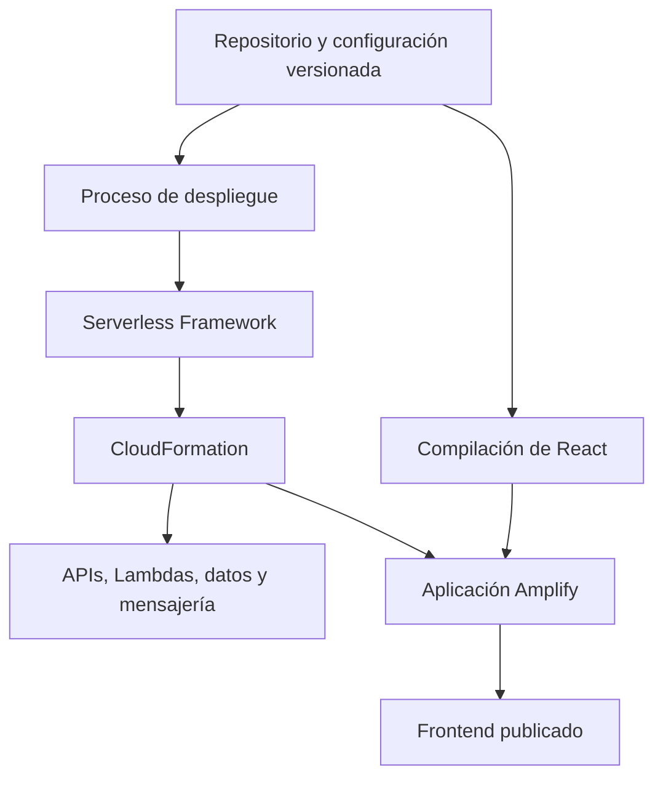

La conexión inicial con la cuenta Git o las credenciales de despliegue se documentan como prerrequisitos autorizados. Los secretos no se incluyen en el repositorio.

### 15.3. Procedimiento que debe documentar el equipo

1. Preparar credenciales autorizadas y seleccionar región/entorno.
2. Instalar las dependencias y usar las versiones registradas en el proyecto.
3. Validar la configuración declarativa.
4. Desplegar infraestructura y backend.
5. Configurar los valores de entorno del frontend a partir de las salidas del despliegue.
6. Compilar y publicar el frontend en Amplify.
7. Crear las cuentas activas de demostración de MS0 por un procedimiento administrado.
8. Ejecutar **desde una MV** el script Python/boto3 de carga directa a DynamoDB, nunca desde la API REST.
9. Ejecutar las verificaciones esenciales y guardar sus evidencias.

Los nombres reales de comandos y opciones deben documentarse al implementar el repositorio. No se incluirán comandos ficticios que aparenten estar disponibles.

### 15.4. Control del entorno

Durante los primeros días se verifican los permisos que ofrece la cuenta del curso, los servicios disponibles y el mecanismo de identidad. Se revisan consumo, registros y recursos que quedan activos.

Los índices, las transacciones, la carga de datos y la retención de registros pueden influir en el uso de recursos. Esta propuesta no asume un costo fijo ni gratuidad del entorno.

## 16. Plan de trabajo y reparto del equipo

### 16.1. Cronograma propuesto

Las fechas intermedias son **metas internas**. Los hitos oficiales están señalados. La hora de entrega se reproduce del enunciado; la planificación del equipo utiliza America/Lima.

| Fechas | Objetivo | Trabajo | Resultado verificable |
|---|---|---|---|
| 27–29 de octubre | Acordar el producto y actualizar requisitos | Rubro, alcance, roles, seis servicios, instrucciones orales y contratos. | Documento de alcance y arquitectura actualizado (v2). |
| 30 de octubre–2 de noviembre | Tener una base desplegada | **MS0 Usuarios primero**, autorizador, tablas de seis servicios, rutas y primera interfaz en Amplify. | Login de dos tenants, una operación protegida por servicio y web accesible. |
| 3–8 de noviembre | Completar el recorrido central | Clientes, técnicos, órdenes, programación y registro de atención utilizando identidad MS0. | Una atención recorre los cinco servicios de negocio, con sesión protegida. |
| 9–12 de noviembre | Conectar archivos y eventos | S3, SNS, SQS, publicadores y consumidores. | Un parte produce los cambios derivados esperados. |
| 13–14 de noviembre | Preparar y presentar avance | Estabilizar el recorrido, recoger evidencias y ensayar. | **Hito oficial: avance del 30 % y exposición virtual con ACL hasta el sábado 14.** |
| 15–18 de noviembre | Completar volumen y casos importantes | Carga desde MV con Python/boto3, conteos, separación, conflictos y reprogramación; aclarar volumen MS0. | Tres tenants con volumen y reglas comprobadas, sin carga por API REST. |
| 19–20 de noviembre | Consolidar documentación | Informe, PPT, diagramas actualizados y README. | Borrador final de entregables. |
| 21 de noviembre | Ensayo completo | Demo, revisión de enlaces y corrección de fallos concretos. | Versión candidata a entrega. |
| 22 de noviembre | Entregar | Comprobar archivos, repositorios y funcionamiento. | **Hito oficial: Canvas hasta las 23:59 del domingo 22.** |
| Semana 16 | Exponer | Presentación y demo en el horario asignado. | **Hito oficial: exposición presencial.** |

El PDF no explica cómo convertir cada funcionalidad en un porcentaje de avance. Este cronograma busca llegar con margen; no afirma que la lista de tareas del 14 de noviembre sea la fórmula oficial del 30 %.

### 16.2. Reparto si son cinco integrantes y existen seis microservicios

El grupo puede seguir teniendo **cinco integrantes**: «seis microservicios» describe componentes de software, **no seis integrantes**. La propuesta combina dos responsabilidades en un integrante y exige revisión cruzada de seguridad.

| Integrante | Responsabilidad principal | Trabajo asociado | Coordinación adicional |
|---|---|---|---|
| 1 | **MS0 Usuarios** + base de MS1 Clientes | Login, cuentas, autorizador, CRUD de Clientes, pruebas de aislamiento. | Contrato de identidad y políticas comunes. |
| 2 | MS2 Técnicos + **MS6 Analítica** | Personal, jornadas, validaciones, pantallas; consumidor de eventos y API de métricas. | Generador y conteos de los siete módulos. |
| 3 | MS3 Órdenes | Estados, detalle, historial y cierre. | Infraestructura y despliegue integrado. |
| 4 | MS4 Agenda + enrutamiento inteligente | Reservas, reprogramación, cancelación, calendario y lógica de sugerencia con MS6. | Pruebas, integración y guion de demo. |
| 5 | MS5 Partes | Atención, evidencias, eventos y pantallas. | Presentación, S3 e informe. |

La tarea de **MS0 es crítica para todos**: aunque el integrante 1 lidere la base, todos verifican autorización en sus APIs. Para equilibrar carga, el CRUD de Clientes puede ser compartido con otro integrante después de estabilizar MS0. Cada responsable entrega código, configuración, pruebas y evidencia de su módulo.

### 16.3. Orden de implementación dentro de cada módulo

1. Acordar el contrato de MS0: token, `tenant_id` confiable, `usuario_id` y roles; después definir entradas, salidas y reglas de cada servicio.
2. Diseñar datos y consultas.
3. Implementar una operación protegida.
4. Conectar su pantalla.
5. Integrar con los otros servicios.
6. Añadir eventos y casos de error cuando correspondan.
7. Generar sus datos ficticios y verificar conteos.
8. Documentar cómo se despliega y cómo se demuestra.

Cada semana debe existir una versión integrada del sistema. La integración comienza con pocos datos y se amplía cuando los contratos son estables.

## 17. Criterios de aceptación y pruebas

La siguiente tabla orienta verificaciones necesarias del comportamiento. No obliga a crear una prueba automatizada por cada detalle visual.

| Caso | Resultado que debe comprobarse |
|---|---|
| API sin autenticación | Rechaza una operación protegida. |
| Gestión de usuarios aislada | El administrador de ClimaLima no lista, crea ni modifica cuentas de FríoSur. |
| Token de otro tenant | No permite forzar el acceso alterando `tenant_id` del body, path o query string. |
| Cuenta inactiva | No permite iniciar sesión ni renovar una sesión activa sin revalidación aplicable. |
| Aislamiento entre empresas | Un usuario de FríoSur no consulta ni modifica una orden de ClimaLima. |
| Permiso del técnico | Solo registra atención sobre una visita que le corresponde. |
| Referencias válidas | Una orden no acepta cliente o ubicación de otro tenant. |
| Creación repetida | Repetir la misma solicitud devuelve la misma orden. |
| Reserva concurrente | Dos intentos sobre el mismo bloque no terminan ambos confirmados. |
| Jornada inválida | Rechaza horario fuera de jornada o durante ausencia. |
| Reprogramación fallida | Conserva la visita y reserva anteriores. |
| Cancelación repetida | No libera dos veces ni vuelve a decrementar contadores. |
| Visita en ejecución | Bloquea reprogramación o cancelación por el flujo normal. |
| Evidencia | El archivo existe y se consulta con autorización. |
| Parte no resuelto | Finaliza la visita, pero mantiene trabajo pendiente en la orden. |
| Mensaje duplicado | Produce el mismo efecto que procesarlo una vez. |
| Mensaje atrasado | No revierte un estado más reciente. |
| Publicación fallida | El evento pendiente puede recuperarse y publicarse. |
| Cierre concurrente | No se confirma una nueva visita después de bloquear el cierre. |
| Datos | Existen al menos 30 000 registros de negocio por cada servicio FSM y tres tenants; el volumen de MS0 queda documentado según la aclaración docente. |
| Carga directa | Se evidencian script Python/boto3, ejecución desde MV y conteos; no se usa API REST para cargas masivas. |
| Despliegue | La configuración y el procedimiento reproducen el entorno previsto. |

**Evidencias útiles:** capturas del resultado, solicitudes y respuestas relevantes, IDs de atención/evento y conteos. Los registros de diagnóstico deben evitar imprimir tokens, credenciales o archivos completos.

Se recomienda automatizar los casos con riesgo de duplicación, concurrencia o acceso cruzado. La revisión de pantallas puede realizarse mediante un recorrido funcional.

## 18. Guion de demostración

### 18.1. Preparación

- Tener cuentas **gestionadas por MS0** para coordinador y técnico de ClimaLima.
- Tener al menos una cuenta de FríoSur para demostrar independencia de usuarios, roles y datos.
- Mantener cargado TecniNorte para evidenciar el tercer tenant.
- Preparar un cliente, un técnico con jornada y una imagen de prueba.
- Conocer los identificadores de los registros que se utilizarán.
- Tener disponibles la arquitectura y los conteos.

### 18.2. Recorrido sugerido

1. Explicar el problema: una empresa necesita organizar una reparación.
2. Entrar mediante MS0 como coordinador de ClimaLima y mostrar empresa y rol verificados.
3. Registrar o seleccionar al cliente y su ubicación.
4. Crear la orden “El equipo no enfría”.
5. Solicitar asignación automática de técnico — el sistema muestra la sugerencia con justificación: *”Carlos — 3 visitas hoy, 95 % resolución sin revisita”*.
6. Aceptar la sugerencia; reservar la visita y mostrarla en la agenda.
7. Abrir el **dashboard de analítica** y mostrar las métricas del tenant actuales.
8. Entrar como técnico en otra pestaña, iniciar la visita y registrar el diagnóstico.
9. Subir una foto y comprobar que puede consultarse.
10. Finalizar el parte — mientras la pestaña del técnico confirma, la pestaña del coordinador muestra la orden actualizándose sola por eventos.
11. Volver al coordinador, cerrar la orden; el dashboard de analítica refleja el cambio inmediatamente.
12. Entrar con una cuenta **independiente** de FríoSur y mostrar sus usuarios, datos y métricas completamente distintos.
13. Mostrar el rechazo de acceso a un usuario y una orden de ClimaLima usando sesión de FríoSur.
14. Presentar conteos de tres tenants, el script directo Python/boto3 y configuración de despliegue.

Si el tiempo lo permite, usar otro caso con `REQUIERE_REVISITA` para mostrar que una orden puede mantenerse abierta después de una atención.

El tiempo de exposición se ajustará al que indique el profesor. El PDF no establece una duración concreta de la demo.

## 19. Entregables, evaluación y fechas oficiales

### 19.1. Informe Word o PDF

Contenido sugerido:

1. Problema, objetivo y alcance.
2. Referencias y decisiones de producto.
3. Actores, roles y reglas del negocio.
4. Arquitectura y explicación de sus componentes.
5. Microservicios, operaciones y propiedad de datos.
6. Diseño JSON de cada servicio y sus consultas.
7. Multi-tenancy, autenticación y autorización.
8. Flujos de archivos y eventos.
9. Automatización del despliegue.
10. Generación y conteos de datos.
11. Evidencias de funcionamiento y pruebas relevantes.
12. Limitaciones del alcance.
13. Enlaces públicos a los repositorios.

### 19.2. Resumen PowerPoint

Se propone una presentación centrada en problema, solución, **seis microservicios (Usuarios + cinco FSM)**, arquitectura, flujo de una atención, separación entre empresas, eventos, carga directa y evidencias. Los diagramas deben coincidir con los recursos efectivamente implementados.

### 19.3. Fechas y condiciones

| Hito oficial | Fecha o condición |
|---|---|
| Grupo | Mantener el del proyecto parcial; hasta cinco integrantes. |
| Avance | Proporcional al 30 %, con exposición virtual con ACL hasta el sábado 14 de noviembre de 2026. |
| Entrega en Canvas | Domingo 22 de noviembre de 2026, hasta las 23:59. |
| Entregables | Informe Word/PDF, enlaces públicos de código y resumen PowerPoint. |
| Presencial y demo | Semana 16, según programación del profesor. |

### 19.4. Rúbrica

| Componente | Puntos |
|---|---:|
| Diagrama de arquitectura de solución | 2 |
| Backend | 8 |
| Frontend | 6 |
| Exposición presencial | 1 |
| Exposición virtual con ACL y avance | 3 |
| **Total** | **20** |

El documento advierte que no presentarse a la exposición presencial implica una evaluación desaprobatoria, con nota máxima de 10. [F1]

## 20. Decisiones que conviene dejar documentadas

| Tema | Decisión de esta propuesta | Alcance o precisión |
|---|---|---|
| Rubro | Aire acondicionado. | Elección propuesta del equipo. |
| Nombre | **Trazora FSM** — «Cada visita bajo control». | Marca creativa provisional, disponibilidad no verificada. |
| Siete microservicios | MS0 Usuarios y acceso + MS1–MS5 Clientes, Técnicos, Órdenes, Agenda y Partes + MS6 Analítica. | MS0 añadido por indicación oral; MS6 añadido para enrutamiento inteligente y dashboard. |
| Persistencia propia | Tablas exclusivas por servicio. | Concreta el requisito usando DynamoDB. |
| Volumen | 30 000 registros para cada microservicio FSM; evaluar MS0. | **Consultar si Usuarios también exige 30 000** y registrar respuesta. |
| Carga | Script Python/boto3 en MV hacia DynamoDB. | **Instrucción oral expresa:** no usar API REST para datos masivos. |
| Identidad | **MS0 Usuarios**, tokens con expiración y autorizador Lambda. | Basarse en Taller Serverless 1; Cognito no disponible en el laboratorio descrito [F17]. |
| Automatización | Serverless Framework y recursos declarativos. | El PDF no especifica versión; documentar la elegida. |
| Cierre | Revisión del coordinador y bloqueo en Agenda. | Evita equiparar un parte final con una orden resuelta. |
| Eventos | Persistencia de pendientes, dos colas e idempotencia. | Recomendaciones de diseño para tolerar fallos concretos. |
| Estados | Reglas explícitas por orden y visita. | Deben mantenerse iguales en backend, frontend y documentos. |
| ACL | Mantener la denominación del PDF. | El enunciado no desarrolla el acrónimo. |
| Presencial | Semana 16. | El PDF no fija un día exacto. |

Las restricciones de 30 minutos, cuatro horas por visita, un técnico principal y formatos de imagen son decisiones del producto académico. Pueden ajustarse antes de implementar si el equipo mantiene coherentes los datos, las pantallas y las reglas.

## 21. Primeras tareas concretas

- [ ] Acordar el rubro y registrar el alcance de la primera versión.
- [ ] Asignar responsables de los **seis microservicios** entre los cinco integrantes.
- [ ] Revisar juntos orden, visita, parte y sus estados.
- [ ] Definir el formato común de IDs, tenant, errores y eventos.
- [ ] **Confirmar con el profesor si MS0 Usuarios también debe contener 30 000 registros.**
- [ ] Verificar permisos del entorno AWS Academy y validar el diseño de MS0 sin depender de Cognito.
- [ ] Crear la estructura del repositorio y la configuración inicial.
- [ ] Implementar MS0 (login, usuarios por tenant, roles y autorizador) antes de conectar las APIs restantes.
- [ ] Publicar una pantalla en Amplify y una operación protegida por cada uno de los seis servicios.
- [ ] Preparar tres tenants con pocos datos y **cuentas propias** de ejemplo.
- [ ] Preparar `scripts/seed/cargar_datos.py` para inserción directa con boto3 desde MV, sin usar endpoints.
- [ ] Completar una atención de extremo a extremo.
- [ ] Implementar MS6 consumidor de eventos y verificar que los contadores se actualizan correctamente.
- [ ] Conectar MS4 con MS6 para la sugerencia de técnico con justificación visible.
- [ ] Construir el dashboard de analítica y el panel de rendimiento por técnico.
- [ ] Registrar evidencias de funcionamiento desde la primera integración.

## 22. Fuentes

Las fuentes respaldan los requisitos del curso y las capacidades de las plataformas. El profesor **sí exige** usuarios multitenant como microservicio y carga directa por boto3 [F16]; la decisión de conservar cinco microservicios FSM y sumar MS0, sus contratos, estados, cronograma interno y nombre creativo son propuestas del equipo.

- **[F16] Explicación oral del profesor (transcripción).** Archivo «Proyecto final audio desde 46m.txt», proporcionado por el usuario. Indica MS de usuarios multitenant, al menos cinco MS protegidos, 30 000 por servicio repartidos en tres tenants, carga directa Python/boto3 desde MV, Amplify, eventos y plazos.
- **[F17] Taller Serverless 1: Sistema de Seguridad.** Archivo «1. Serverless - Taller 1 - V2.00.pdf», diapositiva 7: advierte que Cognito no está disponible en AWS Academy; presenta alta, login, tokens con vencimiento y acceso protegido.
- **[F1] Enunciado del curso.** “2. Proyecto Final (Entrega Semana 15) V5.00 (1).pdf”, proporcionado por el usuario. Páginas 5: rúbrica; 6: asignación FSM; 7: requisitos técnicos; 9: entregables y plazo.
- **[F2] ServiceTitan.** [Dispatch software](https://www.servicetitan.com/features/dispatch-software) y [Field Mobile App](https://www.servicetitan.com/features/field-mobile-app).
- **[F3] Jobber.** [Scheduling](https://www.getjobber.com/features/scheduling/) y [Job Management](https://www.getjobber.com/features/jobs/).
- **[F4] AWS.** [What is AWS Lambda?](https://docs.aws.amazon.com/lambda/latest/dg/welcome.html).
- **[F5] AWS.** [Welcome to Amplify Hosting](https://docs.aws.amazon.com/amplify/latest/userguide/welcome.html).
- **[F6] AWS.** [What is Amazon S3?](https://docs.aws.amazon.com/AmazonS3/latest/userguide/Welcome.html).
- **[F7] AWS.** [Fanout SNS notifications to SQS queues](https://docs.aws.amazon.com/sns/latest/dg/sns-sqs-as-subscriber.html).
- **[F8] AWS.** [Use API Gateway Lambda authorizers](https://docs.aws.amazon.com/apigateway/latest/developerguide/apigateway-use-lambda-authorizer.html).
- **[F9] AWS.** [Multitenancy on DynamoDB](https://docs.aws.amazon.com/whitepapers/latest/multi-tenant-saas-storage-strategies/multitenancy-on-dynamodb.html).
- **[F10] AWS.** [Managing complex workflows with DynamoDB transactions](https://docs.aws.amazon.com/amazondynamodb/latest/developerguide/transactions.html).
- **[F11] AWS.** [Uploading objects with presigned URLs](https://docs.aws.amazon.com/AmazonS3/latest/userguide/PresignedUrlUploadObject.html).
- **[F12] AWS.** [DynamoDB Streams and AWS Lambda triggers](https://docs.aws.amazon.com/amazondynamodb/latest/developerguide/Streams.Lambda.html).
- **[F13] AWS.** [Using Lambda with Amazon SQS](https://docs.aws.amazon.com/lambda/latest/dg/with-sqs.html).
- **[F14] Serverless Framework.** [AWS infrastructure resources](https://www.serverless.com/framework/docs/providers/aws/guide/resources).
- **[F15] AWS.** [AWS::Amplify::App in CloudFormation](https://docs.aws.amazon.com/AWSCloudFormation/latest/TemplateReference/aws-resource-amplify-app.html).

**Consulta inicial de documentación:** 27 de octubre de 2026. **Revisión académica y de alcance:** 29 de octubre de 2026. Antes de implementar, fijar las versiones y verificar las opciones disponibles en la cuenta autorizada del curso.


